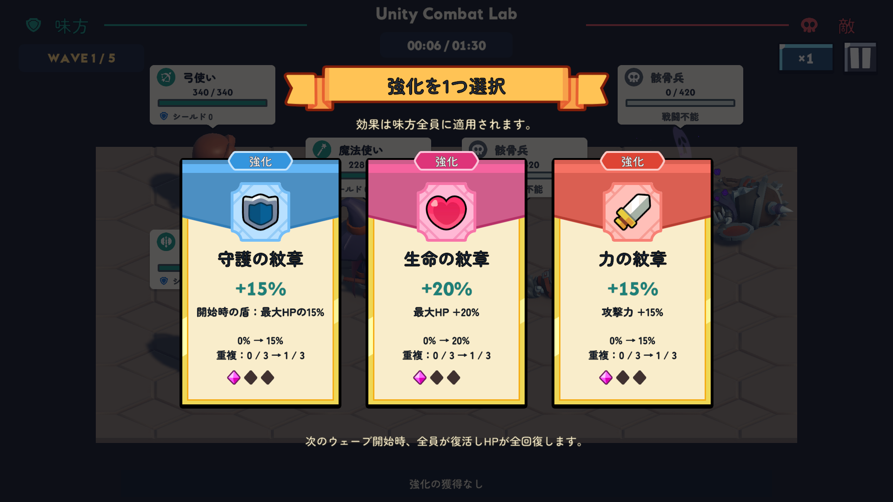
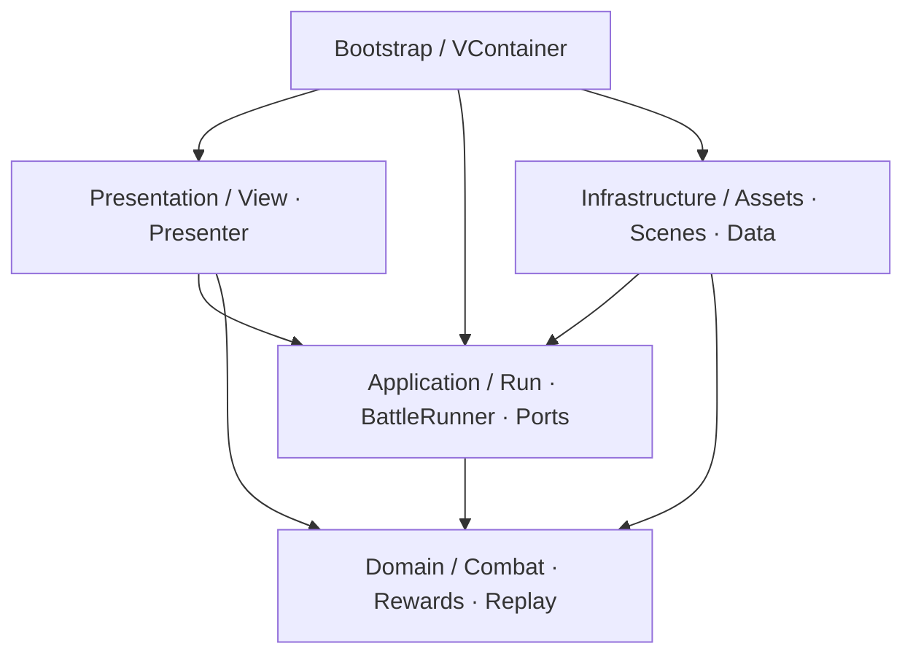

# Unity Combat Lab

[日本語](README.md) | [한국어](README.ko.md) | English

**A Unity game client portfolio project where you position three heroes, choose upgrades between waves, and fight through five waves of automatic combat.**

The placement of the Knight, Ranger, and Mage in the front and back rows, together with your upgrade choices, changes the outcome. The game implements a complete play loop: title → formation → combat → upgrade selection → results → retry. The game UI is in Japanese. This README explains the code and the decisions behind its design.

> **This portfolio project is still in development and is not a finished release.** The main game flow is implemented. Planned work includes integration with a balance authoring tool, sound, and further review and refinement of the game logic.


## Problems addressed in this project

Even in a small auto-battler, **the moment combat is resolved and the moment it appears on screen** can differ, as can **the moment a screen closes and the moment its assets finish loading**. Reproducing the same battle also does not automatically reveal an unintended rule change. The implementation and tests focus on these three problems.

| Problem | Approach | Key code |
|---|---|---|
| HP drops before a projectile hits, and damage and healing appear out of order | Separate resolved combat state from display state, preserving the order of changes across healing events | [UnitPresentationReadModel](Assets/UnityCombatLab/Scripts/Presentation/ReadModels/UnitPresentationReadModel.cs), [BattlePresenter](Assets/UnityCombatLab/Scripts/Presentation/Units/BattlePresenter.cs) |
| A load completes after cancellation or screen closure, leaving asset cleanup without a clear owner | Transfer ownership of each successful load to a Lease, and immediately release results that arrive after their Scope has ended | [AddressableAssetScope](Assets/UnityCombatLab/Scripts/Infrastructure/Assets/AddressableAssetScope.cs), [RunFlowCoordinator](Assets/UnityCombatLab/Scripts/Application/Run/RunFlowCoordinator.cs) |
| An incorrectly changed combat rule still produces matching results when replayed by the same code | Combine reproducibility checks for deterministic 20Hz combat with regression tests against independent, fixed expectations | [BattleRunner](Assets/UnityCombatLab/Scripts/Application/Battle/BattleRunner.cs), [RunReplayTests](Assets/UnityCombatLab/Tests/EditMode/RunReplayTests.cs) |

The project uses more architectural structure than a game of this size alone would require: separate assemblies for each layer, DI, presentation read models, and asset Scopes. This is a deliberate portfolio choice to show **which code needs to change for a given requirement, and which tests verify that change**. Smaller requirements, such as combat slots and state transitions, use fixed arrays and enums.

## Game structure

- **Formation:** Place the Knight, Ranger, and Mage in the front slot and the two back slots (upper and lower). Select cards and slots to swap positions.
- **Combat:** Three allies automatically fight up to three enemies. The Knight reduces incoming damage, the Ranger periodically performs a stronger single-target attack, and the Mage periodically performs an area attack.
- **Upgrades:** After winning each intermediate wave, choose from up to three offers. There are six upgrade types: attack power, maximum HP, attack speed, shield, healing on a kill, and opening attack power. Each can stack up to three times.
- **Progression:** Allies revive and recover to their upgraded maximum HP at the start of the next wave. Upgrades last for one run and reset on a new attempt.
- **Controls:** Switch between 1× and 2× speed, pause and resume, or confirm an exit. Losing focus automatically pauses the game; resuming requires player input.



## Implementation and design decisions

The code blocks below are excerpts from the implementation. Each example links to the full source and relevant tests. A **Run** is one attempt, from departure after formation selection through victory, defeat, or an early exit.

### 1. The hit is resolved, but the arrow has not arrived

**Problem:** Updating the HUD as soon as a combat tick calculates damage makes HP drop before the arrow hits. Moving damage calculation into an animation or Tween completion callback would instead make combat rules depend on animation duration and playback speed.

**Decision:** Damage, death, and victory or defeat are resolved in the pure C# combat core. The screen presents those results at impact time. Application's `BattleReadModel` holds the resolved state, while Presentation's `BattlePresentationReadModel` holds the state to display. [BattlePresentationTimeline](Assets/UnityCombatLab/Scripts/Presentation/Units/BattlePresentationTimeline.cs) schedules attack actions and impacts, and [BattlePresenter](Assets/UnityCombatLab/Scripts/Presentation/Units/BattlePresenter.cs) connects the units and HUD.

Simply displaying every event in receipt order would make an earlier melee hit wait for a slower magic projectile. Instead, **damage can be displayed in impact order, while changes before and after a heal preserve their resolved order.** [UnitPresentationReadModel.PresentChange](Assets/UnityCombatLab/Scripts/Presentation/ReadModels/UnitPresentationReadModel.cs) manages this ordering. It applies HP changes before raising `ChangePresented`, which triggers the corresponding damage number and hit reaction.

For example, a test starts with `100 HP → 16 damage → 8 healing → 16 damage`. Even if the final hit's presentation arrives first, HP is displayed as `100 → 84 → 92 → 76`. The test checks that later damage does not jump ahead of healing, and that the notification used to display damage numbers follows the HP update.

**R3 delivers changes in this display state to the HUD.** The subscription in [BattleHudPresenter](Assets/UnityCombatLab/Scripts/Presentation/UI/BattleHudPresenter.cs) is:

```csharp
unit.Health.Subscribe(value =>
{
    if (!_isDisposed && status != null)
    {
        status.SetHealth(value, unit.Input.MaxHealth);
    }
}).AddTo(_subscriptions);
```

The Presenter owns `_subscriptions` and releases them in `Dispose()`. Maintaining separate resolved and display states adds bookkeeping, but allows presentation timing to change without changing combat calculations or their tests. The game advances to the next wave or results screen after the final impacts and death presentations finish.

**DOTween handles the visual effects in this flow.** It is used for movement toward a target, return movement, and hit reactions in [UnitView](Assets/UnityCombatLab/Scripts/Presentation/Units/UnitView.cs), damage numbers in [DamageNumberView](Assets/UnityCombatLab/Scripts/Presentation/UI/DamageNumberView.cs), and UI popups. Shared UI uses independent timing so menus remain responsive while combat is paused. This is the return expression from [UiTweenUtility.PopIn](Assets/UnityCombatLab/Scripts/Presentation/UI/UiTweenUtility.cs):

```csharp
return DOTween.Sequence()
    .Append(content.DOScale(Vector3.one, seconds).SetEase(Ease.OutBack, 1.7f))
    .Join(DOTween.To(() => group.alpha, alpha => group.alpha = alpha, 1f,
        Mathf.Min(seconds, 0.18f)).SetEase(Ease.OutQuad))
    .SetUpdate(true)
    .SetRecyclable(false);
```

Combat Animators, Tweens, particles, and damage numbers receive a separate playback speed of 0×, 1×, or 2×. VFX reuse per-target-slot instances owned by [UnitEffectsView](Assets/UnityCombatLab/Scripts/Presentation/Units/UnitEffectsView.cs). Damage numbers start with three display slots and add another when all are busy, preserving numbers that are still visible. Returning a slot stops its Tween and changes its generation number so an old callback cannot affect the reused slot.

**Relevant tests:** [UnitPresentationReadModelTests](Assets/UnityCombatLab/Tests/EditMode/UnitPresentationReadModelTests.cs) checks damage arrival order, ordering across healing, and notification after HP application. [BattlePresentationTests](Assets/UnityCombatLab/Tests/PlayMode/BattlePresentationTests.cs) covers Unity display objects and the lifetimes of subscriptions and effects.

### 2. The screen has closed, but its assets finish loading later

**Problem:** Cancelling the Run that is waiting for a load, or destroying its screen, does not necessarily stop an operation already in progress. If the waiting code simply exits, responsibility for releasing the result becomes unclear. Releasing assets while their display objects still exist must also be avoided.

**Decision:** Treat completion of the load and cancellation by its caller as separate events. Each successful load returns an [AddressableAssetLease](Assets/UnityCombatLab/Scripts/Infrastructure/Assets/AddressableAssetLease.cs) that owns its release responsibility. [AddressableAssetManager.LoadAsync](Assets/UnityCombatLab/Scripts/Infrastructure/Assets/AddressableAssetManager.cs) uses UniTask to await the internal load before checking cancellation.

```csharp
var handle = Addressables.LoadAssetAsync<T>(reference.RuntimeKey);
try
{
    var asset = await handle;
    cancellationToken.ThrowIfCancellationRequested();
    if (asset == null)
        throw new InvalidOperationException($"Asset {reference.RuntimeKey} did not produce {typeof(T).Name}.");

    return new AddressableAssetLease<T>(handle);
}
catch
{
    if (handle.IsValid())
        Addressables.Release(handle);

    throw;
}
```

On success, the Lease owns the handle. On failure or cancellation, the loader releases it. [AddressableAssetScope](Assets/UnityCombatLab/Scripts/Infrastructure/Assets/AddressableAssetScope.cs) collects the Leases used by a screen or Run. If the Scope has already ended, it immediately releases a late result instead of retaining it.

```csharp
var lease = await _assets.LoadAsync(reference, cancellationToken);
if (_isDisposed)
{
    lease.Dispose();
    throw new ObjectDisposedException(nameof(AddressableAssetScope));
}
```

This trades immediate cancellation responses for **retaining clear cleanup responsibility until an in-flight load finishes**. Addressables loads local unit definitions, prefabs, UI, and icons. Assets prepared by [RunAssetScope](Assets/UnityCombatLab/Scripts/Infrastructure/Assets/RunAssetScope.cs) are retained across all five waves. VFX are held as dependencies of unit prefabs, so they are not reloaded on every hit.

Run teardown also follows an explicit order. [RunSession](Assets/UnityCombatLab/Scripts/Application/Run/RunSession.cs) owns cancellation for the Run. After input is locked, [RunFlowCoordinator.EndRunAsync](Assets/UnityCombatLab/Scripts/Application/Run/RunFlowCoordinator.cs) performs **cancellation → subscription, effect, and View cleanup → wait for the next frame → asset release**.

```csharp
session.Cancel();
ShowTransitionSafely(Define.RunTransitionPhase.CleaningUp);
session.Battle?.Dispose();
await _nextFrame();
if (_isDisposed)
    return;

session.Resources.Dispose();
```

Waiting for the next frame allows Unity's `Destroy` processing to finish before releasing the assets. Required cleanup proceeds independently of the already-cancelled Run token. The flow then prepares Frontend and clears the Run state.

| Lifetime | Owned objects and when they are released |
|---|---|
| AppRoot | Shared scene transitions, loading UI, EventSystem, and other services used for the lifetime of the application |
| Frontend scene | Title, formation, results, and error UI; Presenters and screen assets. Released when the scene ends |
| Run | Cancellation token, unit and UI assets, progression data, and upgrade history. Released when the Run ends |
| Dungeon / wave | The scene owns the combat Canvas and controls. Runners, units, HUDs, subscriptions, and effects are replaced for each wave |

**Relevant tests:** [AddressableAssetTests](Assets/UnityCombatLab/Tests/PlayMode/AddressableAssetTests.cs) checks shared asset release by the final owner, load completion after cancellation, late completion after Scope disposal, and retries after loading fails. [RunFlowCoordinatorTests](Assets/UnityCombatLab/Tests/EditMode/RunFlowCoordinatorTests.cs) covers both completion orders when application disposal overlaps a cleanup frame wait, as well as release exceptions and late UI access.

### 3. Matching replays do not prove that the rules stayed correct

**Problem:** Bugs are harder to reproduce if frame intervals or 1×/2× speed change attack counts and battle outcomes. Even after solving that problem, recording and replaying with the current code can still pass verification when an incorrect rule change affects both sides in the same way.

**The first decision is to make combat timing and inputs reproducible.** One [BattleSimulation.Step](Assets/UnityCombatLab/Scripts/Domain/Battle/BattleSimulation.cs) represents 50ms, giving a 20Hz simulation. HP, shields, and damage use integers; ratios use basis points (`10000 = 100%`). [BattleRunner](Assets/UnityCombatLab/Scripts/Application/Battle/BattleRunner.cs) converts frame time into ticks, with playback speed applied to the time passed to the Runner.

After delivering a tick's events to the read model and consumers, the Runner acknowledges their consumption:

```csharp
_simulation.Step();
for (var index = 0; index < _simulation.EventCount; index++)
{
    var battleEvent = _simulation.GetEvent(index);
    ReadModel.Apply(battleEvent);
    EventOccurred?.Invoke(battleEvent);
    if (_isDisposed)
    {
        return;
    }
}

_simulation.AcknowledgeEvents();
```

The core reuses a fixed event array. Its unconsumed-event check and the Runner's reentrancy guard prevent the next tick from overwriting a buffer that is still being consumed. `BattleEvent` instances retained by asynchronous presentation code are passed by value.

The Runner processes at most **8 ticks** per frame and carries the remaining time forward. Under heavy load, combat may fall behind real time, but it does not skip simulation ticks. The action order is fixed: **ally front → enemy front → ally upper back → enemy upper back → ally lower back → enemy lower back**. A unit killed by an earlier attack does not act, even within the same tick, so this gives allies a first-action advantage. The game deliberately uses this simple, reproducible sequence of actions.

A completed Run's configuration, seed, upgrade choices, events, and result are stored in [RunReplayRecord](Assets/UnityCombatLab/Scripts/Domain/Run/RunReplayRecord.cs). [RunReplayVerifier](Assets/UnityCombatLab/Scripts/Domain/Run/RunReplayVerifier.cs) recalculates combat without a Unity view and reports the first differing event or result. Events are serialized in a fixed field order using little-endian encoding, then hashed with FNV-1a 64-bit for comparison. The Run ID, which changes on each execution, is excluded.

**The second decision is to keep a regression baseline independent of the current execution.** [RunReplayTests](Assets/UnityCombatLab/Tests/EditMode/RunReplayTests.cs) defines its own inputs, formation, seed, and upgrade choices, then checks fixed expectations for the outcome, per-wave ticks, event counts, choice history, and hash. The main expected values are:

```csharp
private const ulong GoldenEventHash = 0x135806989FA96900UL;
private const int GoldenTotalTicks = 386;
private const int GoldenEventCount = 152;
```

| Check | What it detects |
|---|---|
| Execute the same inputs with different frame intervals and 1×/2× speed | Combat events or outcomes that change with execution timing |
| Recalculate a recorded Run without a view | Differences between the recording and replay, or altered events and choice history |
| Compare fixed inputs against independent expectations | Changes to the established rules' results, even when recording and replay change together |

Fixed expectations require maintenance when the rules change. They are updated, with a documented reason, only when a balance or rule change is intentional.

**Relevant tests:** [BattleSimulationTests](Assets/UnityCombatLab/Tests/EditMode/BattleSimulationTests.cs) checks targeting, damage, death, and termination order. [BattleRunnerTests](Assets/UnityCombatLab/Tests/EditMode/BattleRunnerTests.cs) checks time accumulation, event consumption, and reentrancy. [RunReplayTests](Assets/UnityCombatLab/Tests/EditMode/RunReplayTests.cs) checks the fixed results under three combinations of frame interval and speed, and detects missing events and altered upgrade increments.

### 4. Keep old screen input and previous Run state out of the next step

**Problem:** Repeated upgrade clicks or callbacks arriving late from an old screen can apply the same upgrade twice. Storing runtime state in ScriptableObjects can also make a new attempt inherit HP or upgrades from the previous Run.

**Decision:** [RunController](Assets/UnityCombatLab/Scripts/Application/Run/RunController.cs) checks the current Run ID and phase, while [RunProgress](Assets/UnityCombatLab/Scripts/Domain/Run/RunProgress.cs) validates the wave, offered candidates, and whether a choice is still allowed. A successful choice advances the phase and wave, so a subsequent input cannot apply the same choice again.

```csharp
public bool TrySelectReward(Guid runId, int wave, Define.RewardKind? kind)
{
    if (!Matches(runId, Define.RunPhase.RewardSelection) || !Progress.TryChoose(wave, kind))
        return false;

    SetPhase(Define.RunPhase.WaveIntro);
    return true;
}
```

Upgrade offers use an explicit seed with [xorshift32 PRNG and partial Fisher–Yates sampling](Assets/UnityCombatLab/Scripts/Domain/Run/RewardRandom.cs). The increase granted at selection time is stored in [RewardChoice](Assets/UnityCombatLab/Scripts/Domain/Run/RewardChoice.cs), so the next wave's reward multiplier does not recalculate earlier upgrades.

Authoring data and runtime state are also separate. ScriptableObject settings in [RunDefinition](Assets/UnityCombatLab/Scripts/Infrastructure/Balance/RunDefinition.cs) are converted into validated C# data in [RunGameData](Assets/UnityCombatLab/Scripts/Domain/Run/RunGameData.cs). Run and combat objects own runtime HP and upgrade counts. [RunBattlePresenter](Assets/UnityCombatLab/Scripts/Presentation/UI/RunBattlePresenter.cs) prepares the values needed by upgrade cards in [RewardCardDisplay](Assets/UnityCombatLab/Scripts/Presentation/ReadModels/RewardCardDisplay.cs) and passes them to the View.

**Relevant tests:** [RunProgressTests](Assets/UnityCombatLab/Tests/EditMode/RunProgressTests.cs) checks offers and duplicate choices. [RunControllerTests](Assets/UnityCombatLab/Tests/EditMode/RunControllerTests.cs) checks state transitions and reset on retry. [RunBattleCoordinatorTests](Assets/UnityCombatLab/Tests/EditMode/RunBattleCoordinatorTests.cs) checks five-wave progression without a view, focus recovery, and waiting for presentation to finish.

## Code structure around these responsibilities

Combat rule changes, impact timing changes, and changes to asset loading each have distinct places in the code. These responsibilities are organized using **Clean Architecture Lite + MVP/Passive View**, with R3 for frequently changing HUD values. Clicks and screen transitions use C# events and explicit method calls.

The arrows below show the main code dependencies. References to Common enums and fixed conventions are omitted.



The [Domain asmdef](Assets/UnityCombatLab/Scripts/Domain/UnityCombatLab.Domain.asmdef) sets `noEngineReferences: true` and references only Common. Combat rules and replay verification can run without a Unity view. [Application](Assets/UnityCombatLab/Scripts/Application/UnityCombatLab.Application.asmdef) also has no UnityEngine reference, but uses UniTask and R3 for progression, asynchronous flow, and read models.

Wave progression policy lives in [RunBattleCoordinator](Assets/UnityCombatLab/Scripts/Application/Run/RunBattleCoordinator.cs), while [RunBattleEntryPoint](Assets/UnityCombatLab/Scripts/Bootstrap/RunBattleEntryPoint.cs) connects Unity object creation, frame updates, and focus input. Conditions for advancing to the next wave can therefore be tested without setting up a scene or characters.

**VContainer is used where concrete implementations are assembled.** [AppLifetimeScope.Configure](Assets/UnityCombatLab/Scripts/Bootstrap/AppLifetimeScope.cs) connects the flow coordinator to scene transitions, an asset factory, frame waiting, and error reporting:

```csharp
builder.Register(resolver => new RunFlowCoordinator
(resolver.Resolve<SceneTransitionManager>(),
    loading,
    () => new RunAssetScope(resolver.Resolve<AddressableAssetManager>(), _uiAssets, _unitAssets, _runDefinition),
    () => UniTask.NextFrame(),
    Debug.LogException,
    value => AudioListener.volume = value), Lifetime.Singleton);
builder.RegisterEntryPoint<AppEntryPoint>().AsSelf();
```

Tests replace these connections with doubles to control when loads and frame waits complete. Domain does not query the container. VContainer's scene Scopes and Run asset lifetimes are managed separately: assets needed for an entire Run are distinguished from combat objects replaced each wave, as shown in the lifetime table above.

Data structures and state representations match the actual scale of the game. [BattleSimulation.FindTarget](Assets/UnityCombatLab/Scripts/Domain/Battle/BattleSimulation.cs) examines at most three enemy slots in a fixed order. Dictionaries are used where a Unit ID is needed to look up a View. `RunController` represents phases with an enum and explicit checks for allowed transitions.

## Environment and libraries

These are the installed versions verified in this project. UPM configuration is in [manifest.json](Packages/manifest.json) and [packages-lock.json](Packages/packages-lock.json); NuGet configuration is in [packages.config](Assets/packages.config).

| Technology | Version | Usage and rationale |
|---|---|---|
| Unity / C# | **6000.3.8f1** | Scenes, prefabs, Animator, and game client implementation. [ProjectVersion](ProjectSettings/ProjectVersion.txt) |
| Universal Render Pipeline | **17.3.0** | Rendering the 3D combat stage and characters. [Rendering settings](Assets/UnityCombatLab/Settings) |
| uGUI / TextMeshPro | **Included in uGUI 2.0.0** | Explicit View connections, Japanese UI, and numeric displays. [UI code](Assets/UnityCombatLab/Scripts/Presentation/UI) |
| VContainer | **1.19.0** | Application and scene object composition, plus EntryPoint registration. Container access is concentrated in [Bootstrap](Assets/UnityCombatLab/Scripts/Bootstrap) |
| UniTask | **2.5.11** | Asset preparation, scene transitions, next-frame waits, and cancellation. [RunFlowCoordinator](Assets/UnityCombatLab/Scripts/Application/Run/RunFlowCoordinator.cs) |
| R3 | **1.3.1** — core + Unity integration | Subscribing to HP, shield, and projected HP changes, with explicit subscription cleanup. [BattleHudPresenter](Assets/UnityCombatLab/Scripts/Presentation/UI/BattleHudPresenter.cs) |
| DOTween Standard | **1.3.045** | UI popups, button feedback, movement, hit reactions, and damage numbers. [UiTweenUtility](Assets/UnityCombatLab/Scripts/Presentation/UI/UiTweenUtility.cs), [UnitView](Assets/UnityCombatLab/Scripts/Presentation/Units/UnitView.cs) |
| Addressables | **2.8.1** | Loading local unit definitions, prefabs, UI, and icons. [RunAssetScope](Assets/UnityCombatLab/Scripts/Infrastructure/Assets/RunAssetScope.cs) |
| Input System | **1.18.0** | EventSystem UI input and Esc input. [RunBattleView](Assets/UnityCombatLab/Scripts/Presentation/UI/RunBattleView.cs) |
| Unity Test Framework / NUnit | **1.6.0 package** | EditMode tests for combat and progression; PlayMode tests for Unity objects and asset lifetimes. [Tests](Assets/UnityCombatLab/Tests) |
| NuGetForUnity | **4.5.0** | Restoring R3 core and its .NET dependencies |

Development tools: Rider **2026.2.3.1** / Unity Rider Editor **3.0.39**, and Unity CLI **1.0.0-beta.14** / Pipeline **0.9.1-exp.1**. CLI and MCP were used for Editor operations and verification.

## Tests and reproducibility checks

The following results are from **Unity Editor validation on 2026-10-26**.

| Check | Result |
|---|---|
| EditMode | **110 / 110 passed** |
| PlayMode | **44 / 44 passed** |
| Actual Editor playthrough | Standard difficulty, all 5/5 waves won, **1090 ticks** and **455 events** in total |
| Replay of that playthrough | **MATCH**; expected and actual hashes both `3F80450CE314E9DB` |
| Environment | Unity 6000.3.8f1, 1920×1080, Addressables Asset Database / Fast Mode |

The actual playthrough's 1090 ticks / 455 events and the test fixture's 386 ticks / 152 events come from different inputs.

Test code is linked within each example above. The suite covers numeric calculations along with display ordering, late asynchronous completion, duplicate input, and retries.

## Planned work

- **Balance tool integration:** Connect the game to data from **Fulcrum**, a tool I developed for **curve-driven game balance authoring, simulation, and validation in the Unity Editor**. Fulcrum is maintained in a personal private repository.
- **Sound:** Add background music and combat/UI sound effects. The current demo has no sound.
- **Logic improvements:** Review the existing logic against actual play flows and tests, then refactor and fix it where needed.

## Running the project and restoring assets

Purchased assets are excluded from this repository in accordance with their licenses. Running the project in Unity requires restoring models, textures, animations, GUI assets, fonts, and the project's derived materials and VFX.

To set up a local development environment:

1. Open this repository's root in Unity **6000.3.8f1**. Restore UPM packages using the versions in manifest/lock.
2. Use `NuGet > Restore Packages` to restore R3 core and the dependencies in [packages.config](Assets/packages.config). The generated `Assets/Packages/` directory is excluded from Git.
3. Restore DOTween Standard **1.3.045** from its official distribution and configure it through `Tools > Demigiant > DOTween Utility Panel`. Retain the distribution and its notices; `Assets/Plugins/Demigiant/` is not included in the public repository.
4. Restore TMP resources using `Window > TextMeshPro > Import TMP Essential Resources`.
5. If you own the external assets listed below, import them yourself while preserving their original paths and GUIDs. Do not obtain them by copying another person's purchased assets.
6. After importing the asset packs, separately configure the project's derived URP materials and VFX wrappers, then assign references in the custom unit/UI prefabs and asset catalogs.
7. Once assets and references are restored, start from [Boot.unity](Assets/UnityCombatLab/Scenes/Boot.unity). Running Dungeon directly requires an active Run. Scene order must match [Define.SceneType](Assets/UnityCombatLab/Scripts/Common/Define.cs): `Boot=0 / Dungeon=1 / Frontend=2`.

Run `UnityCombatLab.Tests` in the Unity Test Runner's EditMode and PlayMode tabs. Tests that use asset references require the restoration steps above. After a battle ends, remain in Play mode and select `UnityCombatLab > Development > Verify Last Run` to see replay verification for the most recently completed Run in the Console.

## Implementation scope and external resources

The custom implementation covers combat, upgrades, progression rules, UI and effect coordination, asynchronous flow and asset lifetimes, tests, replay verification, and project-specific prefab and scene setup. The original character, environment, GUI, and VFX assets come from the following resources.

| Resource | Provider / purpose | Treatment in this repository |
|---|---|---|
| KayKit Adventurers / Skeletons / Dungeon Remastered | Kay Lousberg / characters, equipment, animations, and stage assets | Original assets under `Assets/KayKit/` excluded |
| GUI Pro - Minimal Game Light | LAYERLAB / UI graphics and icons; LTAvocado Bold and Afacad Flux ExtraBold font references | Original assets under `Assets/Layer Lab/` excluded |
| [Epic Toon FX](https://assetstore.unity.com/packages/vfx/particles/epic-toon-fx-57772) | Archanor VFX / combat effects | Original assets under `Assets/Epic Toon FX/` excluded |
| Project-derived materials and VFX wrappers | Local assets built around the purchased resources above | `Assets/UnityCombatLab/Art/Restricted/` excluded |
| Zen Maru Gothic Bold | Zen Maru Gothic Project Authors / Japanese UI | Original font, generated TMP atlas, [NOTICE](Assets/UnityCombatLab/Art/Fonts/ZenMaruGothic/NOTICE.txt), and [OFL](Assets/UnityCombatLab/Art/Fonts/ZenMaruGothic/OFL.txt) included |

Excluded paths are listed in [.gitignore](.gitignore). Custom wrappers reference external resources, so both the original assets and project-derived assets must be restored.

Development includes implementation drafts, Editor operations, and automated verification using Codex and Unity CLI/MCP. Changes have been incorporated through design and scope decisions, code review and revision, and play checks.
