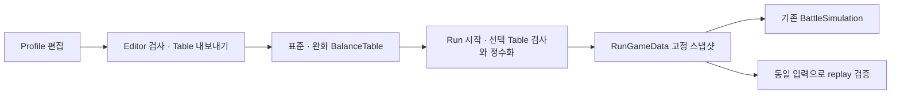
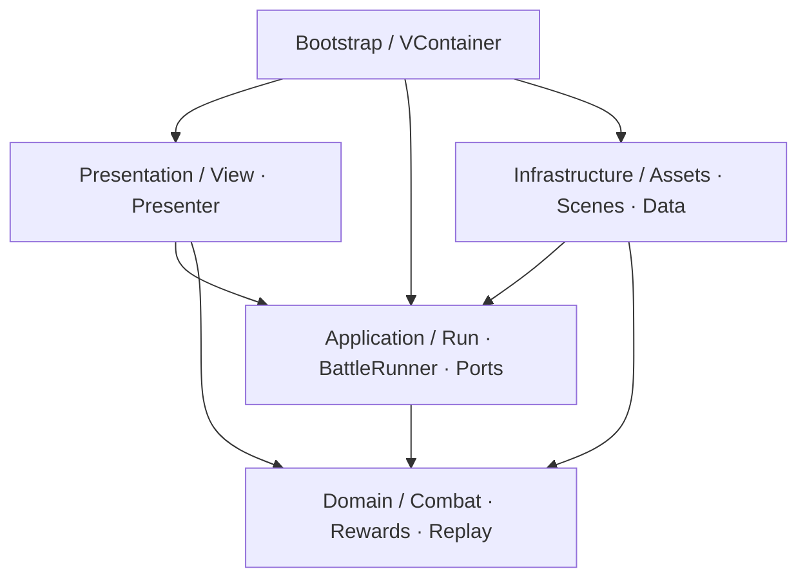

# Unity Combat Lab

[日本語](README.md) | [한국어](README.ko.md) | [English](README.en.md)

**목차:** [소개](#프로젝트-소개) · [사용 환경](#사용-환경과-라이브러리) · [Fulcrum](#fulcrum-소개) · [코드 구조](#코드-구조) · [검증 결과](#테스트와-검증-결과) · [구현 상세](#구현과-설계-판단) · [실행 안내](#프로젝트-실행과-에셋-복원)

## 프로젝트 소개

**3명의 영웅을 배치하고, 웨이브 사이의 강화를 선택해 5번의 자동전투를 돌파하는 Unity 클라이언트 포트폴리오입니다.**

기사·궁수·마법사의 전열/후열 배치와 강화 조합이 전투 결과를 바꿉니다. 타이틀 → 편성 → 전투 → 강화 선택 → 결과 → 재도전까지 한 판의 흐름을 구현했습니다. 게임 UI는 일본어이며, 이 README는 코드와 설계 의도를 설명하는 한국어 문서입니다. **Run**은 편성을 마치고 출발한 뒤 클리어·패배·중도 종료에 이르기까지의 한 판을 뜻합니다.

구매 에셋은 저장소에 포함하지 않으므로 Unity에서 실행하려면 [에셋과 참조를 복원](#프로젝트-실행과-에셋-복원)해야 합니다.

> **현재 개발 중인 포트폴리오이며, 최종 완성본은 아닙니다.** 주요 게임 흐름과 Fulcrum 밸런스 데이터 연동을 구현했습니다. 사운드 추가·안정성 점검·로직 개선은 이후 작업입니다.


## 사용 환경과 라이브러리

버전은 이 프로젝트에서 확인한 설치 버전입니다. UPM 구성은 [manifest.json](Packages/manifest.json)과 [packages-lock.json](Packages/packages-lock.json), NuGet 구성은 [packages.config](Assets/packages.config)에 있습니다.

| 기술 | 버전 | 실제 사용처와 선택 이유 |
|---|---|---|
| Unity / C# | **6000.3.8f1** | 씬·프리팹·Animator와 게임 클라이언트 구현. [ProjectVersion](ProjectSettings/ProjectVersion.txt) |
| Universal Render Pipeline | **17.3.0** | 3D 전투 무대와 캐릭터 렌더링. [렌더링 설정](Assets/UnityCombatLab/Settings) |
| uGUI / TextMeshPro | **uGUI 2.0.0에 포함** | 명시적으로 연결하는 View, 일본어 UI와 숫자 표시. [UI 코드](Assets/UnityCombatLab/Scripts/Presentation/UI) |
| VContainer | **1.19.0** | 앱·씬의 객체 조립과 EntryPoint 연결. 컨테이너 접근을 [Bootstrap](Assets/UnityCombatLab/Scripts/Bootstrap)에 모음 |
| UniTask | **2.5.11** | 자산 준비, 씬 전환, 다음 프레임 대기, 취소 처리. [RunFlowCoordinator](Assets/UnityCombatLab/Scripts/Application/Run/RunFlowCoordinator.cs) |
| R3 | **1.3.1** — core + Unity 연동 | HP·방어막·예고 HP의 변경 구독과 해제. [BattleHudPresenter](Assets/UnityCombatLab/Scripts/Presentation/UI/BattleHudPresenter.cs) |
| DOTween Standard | **1.3.045** | UI 팝업, 버튼 반응, 이동·피격·피해 숫자 연출. [UiTweenUtility](Assets/UnityCombatLab/Scripts/Presentation/UI/UiTweenUtility.cs), [UnitView](Assets/UnityCombatLab/Scripts/Presentation/Units/UnitView.cs) |
| Addressables | **2.8.1** | 로컬 유닛 정의·프리팹·UI·아이콘 로딩. [RunAssetScope](Assets/UnityCombatLab/Scripts/Infrastructure/Assets/RunAssetScope.cs) |
| Input System | **1.18.0** | EventSystem의 UI 입력과 Esc 입력. [RunBattleView](Assets/UnityCombatLab/Scripts/Presentation/UI/RunBattleView.cs) |
| Unity Test Framework / NUnit | **1.6.0 패키지** | 전투·진행의 EditMode 테스트와 Unity 객체·자산 수명의 PlayMode 테스트. [Tests](Assets/UnityCombatLab/Tests) |
| NuGetForUnity | **4.5.0** | R3 core 및 관련 .NET 의존성 복원 |
| Fulcrum | **0.4.0 / MIT / embedded** | 웨이브별 수치 작성·Table 출력과 Run 입력 변환. [패키지 출처](Packages/FULCRUM_SOURCE.md) |

개발 환경은 Rider **2026.2.3.1** / Unity Rider Editor **3.0.39**, Unity CLI **1.0.0-beta.14** / Pipeline **0.9.1-exp.1**입니다. CLI·MCP는 에디터 작업과 검증에 사용했습니다.

## 게임 구성

https://github.com/user-attachments/assets/15fbbef9-a48c-4ae0-be49-c97b5fea7cce

[전체 플레이 영상 (MP4 · 62 s · 1.9 MB)](Docs/Videos/gameplay-demo.mp4)

- **편성:** 기사·궁수·마법사를 전열, 위쪽 후열, 아래쪽 후열에 배치합니다. 카드와 슬롯을 선택해 위치를 교환합니다.
- **전투:** 아군 3명과 최대 3명의 적이 자동으로 싸웁니다. 기사는 피해 감소, 궁수는 주기적인 강한 단일 공격, 마법사는 주기적인 광역 공격을 사용합니다.
- **강화:** 중간 웨이브 승리 시 최대 3개 후보 중 하나를 선택합니다. 공격력·최대 HP·공격 속도·방어막·처치 회복·초반 공격력의 6종이며, 각 종류는 최대 3회 중첩됩니다.
- **진행:** 다음 웨이브에서 아군은 부활하고 강화된 최대 HP로 회복합니다. 강화는 한 판 동안 유지되며 새 도전에서는 초기화됩니다.
- **조작:** 1배/2배속, 일시정지·재개, 종료 확인을 제공합니다. 포커스를 잃으면 자동 일시정지하고 직접 재개합니다.

## 핵심 문제와 해결 요약

작은 자동전투 게임에서도 **전투가 확정되는 시점과 화면에 보이는 시점**, **화면이 끝나는 시점과 로딩이 끝나는 시점**은 다릅니다. 또한 같은 전투를 재현할 수 있어도, 규칙을 잘못 바꾼 사실까지 자동으로 발견되는 것은 아닙니다. 이 프로젝트는 다음 네 문제를 중심으로 구현과 테스트를 구성했습니다.

| 문제 | 해결 방식 | 주요 코드 |
|---|---|---|
| 투사체가 닿기 전에 HP가 줄고, 피해·회복의 표시 순서가 어긋남 | 확정된 전투 상태와 표시 상태를 분리하고, 회복 전후의 적용 순서를 보존 | [UnitPresentationReadModel](Assets/UnityCombatLab/Scripts/Presentation/ReadModels/UnitPresentationReadModel.cs), [BattlePresenter](Assets/UnityCombatLab/Scripts/Presentation/Units/BattlePresenter.cs) |
| 취소하거나 화면을 닫은 뒤 로딩이 완료되어 자산의 해제 책임이 사라짐 | 성공한 로드의 소유권을 Lease로 넘기고, 종료된 Scope에 도착한 결과는 즉시 해제 | [AddressableAssetScope](Assets/UnityCombatLab/Scripts/Infrastructure/Assets/AddressableAssetScope.cs), [RunFlowCoordinator](Assets/UnityCombatLab/Scripts/Application/Run/RunFlowCoordinator.cs) |
| 잘못 변경한 전투 규칙도 현재 코드로 재실행하면 같은 결과가 나옴 | 20Hz 결정론 전투의 재현 검사와 독립된 고정 기대값의 회귀 검사를 함께 구성 | [BattleRunner](Assets/UnityCombatLab/Scripts/Application/Battle/BattleRunner.cs), [RunReplayTests](Assets/UnityCombatLab/Tests/EditMode/RunReplayTests.cs) |
| 이전 화면의 입력이나 Run 상태가 다음 진행에 섞여 강화가 중복 적용되거나 재도전이 초기화되지 않음 | Run ID·상태·후보를 검증하고, 편집 데이터와 한 판의 실행 상태를 분리 | [RunController](Assets/UnityCombatLab/Scripts/Application/Run/RunController.cs), [RunProgress](Assets/UnityCombatLab/Scripts/Domain/Run/RunProgress.cs) |

전투 규칙, 화면의 표시 타이밍, 자산 로딩 방식을 각각 수정하고 검사할 수 있도록 책임을 나눴습니다. 계층별 어셈블리와 DI는 구현의 연결을, 표시 전용 읽기 모델은 HUD에 보여줄 상태를, 자산 Scope는 해제 범위를 담당합니다. **변경할 코드와 확인할 테스트의 범위를 분명히 하는 것**이 목적입니다. 전투 슬롯과 상태 전이처럼 요구가 작은 부분은 고정 배열과 enum으로 구현했습니다.

## Fulcrum 소개

**Fulcrum은 개인적으로 개발하고 관리하는 Unity Editor용 게임 밸런스 제작 도구입니다.** 성장 곡선과 수치 데이터를 그래프로 확인하면서 편집하고, 결과를 게임이 읽을 수 있는 Table이나 CSV로 내보냅니다. 반복해서 수정하는 밸런스 데이터를 코드와 분리해 관리하고, 수치가 어떻게 변하는지 한눈에 확인하기 위해 만들었습니다.

Profile은 축·트랙·계산 모델을 담는 편집 원본이고, BalanceTable은 그 Profile을 평가해 얻은 출력 데이터입니다. Fulcrum 자체에는 범용 시뮬레이션·검증 기능도 있지만, 실제 게임 규칙과 결과 검증은 각 게임의 전투 코어가 담당하도록 구분합니다.

## 이 프로젝트에서의 Fulcrum 활용

Unity Combat Lab에서는 Fulcrum으로 **웨이브별 적 HP·공격력과 강화 효과 배율**을 관리합니다. 게임 C# 코드의 수치를 직접 고치는 대신 표준·완화 난이도 Profile을 편집하고, Table을 재출력해 다음 Run에 반영합니다. 아래는 이 프로젝트에 연결한 실제 Profile과 사용 흐름입니다.


위 화면은 이 게임에서 사용하는 `BalanceProfile_Standard`의 `enemy_hp` 트랙입니다. 가로축은 **1~5웨이브**, 세로축은 **역할 계수 적용 전 적 HP**입니다. 현재 모델은 다섯 값을 직접 입력하는 **Hand-written values**이며, 오른쪽 `Values`를 펼쳐 각 웨이브 값을 수정하면 중앙 그래프도 바뀝니다. 예를 들어 1웨이브 HP를 올리면 해당 웨이브의 적을 쓰러뜨리는 데 필요한 공격 횟수가 늘어납니다.

### 그래프에서 실제 전투까지의 연결



[RunBalanceExporter](Assets/UnityCombatLab/Editor/RunBalanceExporter.cs)는 Profile의 `wave` 축 1~5, 필수 트랙과 표준·완화 관계를 검사합니다. Table에는 축 이름이 저장되지 않으므로 [FulcrumBalanceAdapter](Assets/UnityCombatLab/Scripts/Infrastructure/Balance/FulcrumBalanceAdapter.cs)는 게임 시작 시 트랙 누락·범위 부족·NaN/Infinity·입력 안전 범위를 확인합니다. 잘못된 값은 기본값으로 바꾸지 않고 Run 시작을 거부하며 기존 자원 정리와 오류 안내 경로로 연결합니다.

[RunDefinition](Assets/UnityCombatLab/Scripts/Infrastructure/Balance/RunDefinition.cs)은 난이도별 Table을 고르고, 적 배치를 가진 [WaveDefinition](Assets/UnityCombatLab/Scripts/Infrastructure/Balance/WaveDefinition.cs)과 결합해 순수 C#의 [RunGameData](Assets/UnityCombatLab/Scripts/Domain/Run/RunGameData.cs)를 만듭니다. Domain/Application에는 Fulcrum 타입을 전달하지 않으며, 게임 런타임의 직접 참조는 Infrastructure의 `Fulcrum.Core`로 제한합니다. 진행 중인 Run과 replay는 이 고정 스냅샷을 사용하므로 이후 Profile 편집의 영향을 받지 않습니다.

**이 그래프는 입력 수치를 보여주며 게임 승패를 예측하는 그래프가 아닙니다.** 화면 하단의 `Simulation not configured`는 Fulcrum 자체의 범용 시뮬레이터를 이 Profile에 설정하지 않았다는 뜻입니다. 게임 전투는 기존 `BattleSimulation`이 수행하고, 결과의 재현성은 게임의 `RunReplayVerifier`로 확인합니다. 두 시뮬레이터를 동기화하거나 실시간으로 게임 수치를 덮어쓰는 기능은 없습니다.

### 이 게임에서 조정하는 값

| 트랙 | 게임에 적용되는 값 | 표준 Profile의 1~5웨이브 초깃값 |
|---|---|---|
| `enemy_hp` | 적 역할 계수를 곱하기 전 기본 HP | 420 / 500 / 600 / 700 / 800 |
| `enemy_attack` | 적 역할 계수를 곱하기 전 기본 공격력 | 12 / 14 / 17 / 20 / 24 |
| `reward_strength` | 강화 선택 시 기본 효과에 곱할 배율 | 1.00 / 1.10 / 1.20 / 1.30 / 1.40 |

`reward_strength`는 적 처치 보상 금액이 아니라 **선택하는 강화의 효과 배율**입니다. 기본 공격력 강화가 +15%이고 해당 웨이브 배율이 1.10이면, 그 선택은 +16.5%로 확정되어 Run에 저장됩니다. 5웨이브 값도 Table에는 있지만 최종 승리 뒤에는 강화 선택이 없습니다.

### 수정한 수치를 게임에 적용하는 순서

1. Unity 메뉴 **Window → Fulcrum → Balance Editor**를 엽니다.
2. 상단 `Profile`에 [BalanceProfile_Standard](Assets/UnityCombatLab/Data/Balance/BalanceProfile_Standard.asset)를 지정하고, 왼쪽 트랙을 선택해 오른쪽 모델의 `Values`를 수정합니다. 배열의 첫 번째 값부터 1~5웨이브에 대응합니다.
3. [BalanceProfile_Easy](Assets/UnityCombatLab/Data/Balance/BalanceProfile_Easy.asset)도 적 HP·공격력이 표준의 80%, 강화 배율은 동일하도록 맞춥니다. 두 Profile은 자동으로 동기화되지 않습니다.
4. **Play 모드를 종료한 상태에서 Tools → UnityCombatLab → Export Run Balance Tables**를 실행합니다. 두 Profile을 검사한 뒤 기존 표준·완화 Table을 갱신합니다. 그래프 창의 일반 `Export Table` 대신 이 게임 전용 메뉴를 사용하면 축·입력 범위·난이도 비율까지 확인할 수 있습니다.
5. Play 모드에서 편성 화면의 난이도를 선택하고 **새 Run을 시작**합니다. 선택한 난이도의 최신 Table이 적용됩니다.

**Profile을 수정하고 저장하는 것만으로 게임에 적용되지는 않습니다.** 명시적으로 Table을 내보내야 하며, 이미 시작한 Run은 처음 읽은 수치를 끝까지 유지합니다. `BalanceTable_Standard`와 `BalanceTable_Easy`는 출력 결과물이므로 편집은 Profile에서 합니다.

예를 들어 표준 1웨이브 HP를 `420 → 500`으로 바꾸면 완화도 `336 → 400`으로 맞춘 뒤 재출력합니다. 다음 Run의 근접 적은 각각 500 / 400 HP로 시작합니다. 해당 변경이 승패나 클리어 시간에 미치는 영향은 실제 게임 코어로 다시 확인합니다.

### 입력 변환과 패키지 구성

완화 난이도 Profile은 표준의 **적 HP·공격력 ×0.8**, 강화 배율은 동일합니다. HP와 공격력은 Table을 읽을 때 `MidpointRounding.AwayFromZero`로 정수화합니다. 따라서 완화 기본 공격력은 `10 / 11 / 14 / 16 / 19`입니다. 이후 원거리·대장 같은 역할 계수와 전투 피해 계산에는 기존 정수 내림 규칙을 사용합니다. 예를 들어 완화 1웨이브 공격력은 `12 × 0.8 = 9.6 → 10`이며 게임에서 80%를 다시 곱하지 않습니다.

Fulcrum **0.4.0**은 검증한 원본 revision의 패키지만 `Packages/com.hakrimryu.fulcrum`에 embedded로 포함했습니다. 개인 PC의 절대경로나 비공개 저장소 접근에 의존하지 않습니다. 사용 revision·출처는 [FULCRUM_SOURCE](Packages/FULCRUM_SOURCE.md), MIT 저작권·허가문은 [LICENSE](Packages/com.hakrimryu.fulcrum/LICENSE.md)에 보존했습니다. 연동 회귀 테스트는 [FulcrumBalanceAdapterTests](Assets/UnityCombatLab/Tests/EditMode/FulcrumBalanceAdapterTests.cs)에 있습니다.

## 코드 구조

전투 규칙을 바꾸는 작업, 화면의 명중 타이밍을 바꾸는 작업, 자산 로딩 방식을 바꾸는 작업의 수정 범위를 구분했습니다. 이 책임 분리를 **Clean Architecture Lite + MVP/Passive View**로 구성하고, 자주 바뀌는 HUD 값에 R3를 적용했습니다. 클릭·화면 전환은 C# 이벤트와 명시적 메서드 호출로 처리합니다.

아래 화살표는 주요 코드 의존 방향입니다. Common의 enum·고정 규약 참조는 생략했습니다.



[Domain asmdef](Assets/UnityCombatLab/Scripts/Domain/UnityCombatLab.Domain.asmdef)는 `noEngineReferences: true`이며 Common만 참조합니다. 전투 규칙과 replay는 Unity 화면 없이 실행할 수 있습니다. [Application](Assets/UnityCombatLab/Scripts/Application/UnityCombatLab.Application.asmdef)도 UnityEngine을 참조하지 않지만 진행·비동기 흐름·읽기 모델에 UniTask와 R3를 사용합니다.

웨이브 진행 정책은 [RunBattleCoordinator](Assets/UnityCombatLab/Scripts/Application/Run/RunBattleCoordinator.cs)에 두고, [RunBattleEntryPoint](Assets/UnityCombatLab/Scripts/Bootstrap/RunBattleEntryPoint.cs)는 Unity 객체 생성과 프레임·포커스 입력을 연결합니다. 덕분에 다음 웨이브로 넘어가는 조건을 검사할 때 씬과 캐릭터를 준비할 필요가 없습니다.

**VContainer는 구체 구현을 조립하는 위치에 사용합니다.** [AppLifetimeScope.Configure](Assets/UnityCombatLab/Scripts/Bootstrap/AppLifetimeScope.cs)에서 흐름 조정 객체에 씬 전환, 자산 생성 함수, 프레임 대기와 오류 보고를 연결합니다.

```csharp
builder.Register(resolver => new RunFlowCoordinator
(resolver.Resolve<SceneTransitionManager>(),
    loading,
    configuration => new RunAssetScope(resolver.Resolve<AddressableAssetManager>(), _uiAssets, _unitAssets, _runDefinition, configuration),
    () => UniTask.NextFrame(),
    Debug.LogException,
    value => AudioListener.volume = value), Lifetime.Singleton);
builder.RegisterEntryPoint<AppEntryPoint>().AsSelf();
```

테스트에서는 이 연결을 대역으로 바꿔 로드 완료와 프레임 대기 시점을 직접 제어합니다. Domain은 컨테이너를 조회하지 않습니다. VContainer의 씬 Scope와 Run 자산의 수명은 별도로 관리하며, [구현 상세의 소유 기간 표](#2-화면은-종료됐는데-자산-로딩은-나중에-끝난다)처럼 한 판 동안 유지할 자산과 웨이브마다 교체할 전투 객체를 구분합니다.

자료구조와 상태 표현은 실제 크기에 맞췄습니다. [BattleSimulation.FindTarget](Assets/UnityCombatLab/Scripts/Domain/Battle/BattleSimulation.cs)은 최대 3개 적 슬롯을 정해진 순서로 검사하고, Unit ID로 View를 찾는 곳에는 Dictionary를 사용합니다. `RunController`의 상태는 enum과 허용 전이 검사로 표현합니다.

## 테스트와 검증 결과

**2026-10-27 Unity Editor에서 Fulcrum 연동을 포함해 실행한 검증 결과**입니다. 실제 전투는 Editor 프레임으로 진행하고, 개발용 입력 API로 편성·배속·강화를 선택했습니다. 마우스 조작 전체를 자동화한 검증은 아닙니다.

| 검증 | 결과 |
|---|---|
| EditMode | **177 / 177 통과** |
| PlayMode | **47 / 47 통과** |
| 실제 Editor 전투 — 표준 | 5/5웨이브 승리, **1090tick / 455이벤트**, replay **MATCH** (`3F80450CE314E9DB`) |
| 실제 Editor 전투 — 완화 | 5/5웨이브 승리, **872tick / 371이벤트**, replay **MATCH** (`E504B1BB12FD5095`) |
| 잘못된 Table의 출발 | 필수 트랙·범위·비정상 값 거부, Table 누락 시 취득 자산 정리·오류 화면 복귀 확인 |
| 실행 환경 | Unity 6000.3.8f1, Addressables Asset Database / Fast Mode |

실제 플레이의 1090tick/455이벤트와 테스트 전용 고정 입력의 386tick/152이벤트는 서로 다른 입력에 대한 결과입니다.

관련 테스트 코드는 아래 [구현과 설계 판단](#구현과-설계-판단)의 각 사례에 연결했습니다. 값의 계산뿐 아니라 표시 순서, 늦은 비동기 완료, 중복 입력과 재시작을 함께 검사하도록 구성했습니다.

Fulcrum의 출력이 실제 전투에 연결되는지도 다음과 같이 확인했습니다. 편성은 마법사/궁수/기사, 시드는 `20261024`, 강화 순서는 공격력 → 공격력 → 처치 회복 → 공격력입니다.

| 검증 단계 | 실제 확인한 동작 |
|---|---|
| 표준 Run 시작 후 Profile 재출력 | 검증용으로 1웨이브 HP를 420에서 1,000,000으로 바꾸고 완화도 80%로 맞춰 출력. 이미 진행 중인 Run은 기존 HP 420을 유지하고 기존 결과로 승리 |
| 변경 후 새 표준 Run | 새 Table의 HP 1,000,000을 사용해 **1800tick 시간초과 / 501이벤트**로 결과 변경. replay **MATCH** (`3646720722658195`) |
| 기본 수치 복원 후 완화 Run | 1웨이브 HP 336·공격력 10으로 시작하고 5웨이브 승리. 종료 뒤 유닛 정리 확인 |

1,000,000 HP는 밸런스 추천값이 아니라 **입력 변경이 실제 결과에 반영되는지 확인하기 위한 검증값**입니다. 이 재출력 검증은 개발용 Editor API로 실행했으며, 일반 사용 메뉴는 앞의 절차처럼 Edit 모드에서 실행합니다. 검증 후 Profile·Table과 meta는 모두 검증 전 파일과 바이트가 같도록 복원했습니다.

현재 제출 범위는 GitHub 저장소입니다. Android/WebGL 빌드·배포와 실기기 성능 검증은 보류 상태이며 위 Editor 결과로 대체하지 않습니다. 외부 구매 에셋을 제외한 새 clone의 전체 복원도 검증하지 않았습니다.

## 구현과 설계 판단

아래 코드 블록은 실제 구현의 핵심 부분을 발췌했습니다. 각 사례에 전체 소스와 관련 테스트를 연결했습니다.

### 1. 전투 결과는 확정됐지만, 화살은 아직 도착하지 않았다

**문제.** 전투 tick에서 피해를 계산하자마자 HUD를 갱신하면 화살이 닿기 전에 HP가 줄어듭니다. 반대로 피해 계산을 애니메이션이나 Tween 완료에 맡기면 연출 시간과 배속 변경이 전투 규칙에 영향을 줍니다.

**선택.** 피해·사망·승패는 순수 C# 전투 코어에서 확정하고, 화면은 그 결과를 명중 시점에 표시합니다. Application의 `BattleReadModel`은 확정된 상태를, Presentation의 `BattlePresentationReadModel`은 화면에 보일 상태를 보관합니다. [BattlePresentationTimeline](Assets/UnityCombatLab/Scripts/Presentation/Units/BattlePresentationTimeline.cs)이 공격 동작과 명중 예약을 관리하고, [BattlePresenter](Assets/UnityCombatLab/Scripts/Presentation/Units/BattlePresenter.cs)가 유닛과 HUD를 연결합니다.

단순히 모든 이벤트를 받은 순서대로 표시하면 늦게 도착하는 마법탄 때문에 먼저 닿은 근접 공격까지 기다리게 됩니다. 따라서 **피해끼리는 도착 순서대로 표시하고, 회복 전후에는 확정된 순서를 지킵니다.** [UnitPresentationReadModel.PresentChange](Assets/UnityCombatLab/Scripts/Presentation/ReadModels/UnitPresentationReadModel.cs)가 이 순서를 관리합니다. HP를 먼저 적용한 뒤 `ChangePresented`로 같은 피해의 숫자·피격 연출을 알립니다.

예를 들어 테스트의 HP `100 → 피해 16 → 회복 8 → 피해 16`은, 마지막 피해의 연출이 먼저 도착해도 `100 → 84 → 92 → 76` 순서로 표시합니다. 회복을 건너뛰어 피해를 먼저 적용하거나, HP 갱신 전에 피해 숫자만 나오는 상황을 검사합니다.

**R3는 이 표시 상태가 바뀔 때 HUD에 전달하는 데 사용합니다.** [BattleHudPresenter](Assets/UnityCombatLab/Scripts/Presentation/UI/BattleHudPresenter.cs)의 구독은 다음과 같습니다.

```csharp
unit.Health.Subscribe(value =>
{
    if (!_isDisposed && status != null)
    {
        status.SetHealth(value, unit.Input.MaxHealth);
    }
}).AddTo(_subscriptions);
```

Presenter가 `_subscriptions`를 소유하고 `Dispose()`에서 해제합니다. 확정 상태와 표시 상태를 따로 유지하는 비용은 생기지만, 연출 타이밍을 바꿔도 전투 계산과 그 테스트는 유지할 수 있습니다. 마지막 명중·사망 표시가 끝난 뒤 다음 웨이브 또는 결과 화면으로 넘어갑니다.

**DOTween은 이 과정의 시각적 표현을 담당합니다.** [UnitView](Assets/UnityCombatLab/Scripts/Presentation/Units/UnitView.cs)의 접근·복귀와 피격, [DamageNumberView](Assets/UnityCombatLab/Scripts/Presentation/UI/DamageNumberView.cs)의 피해 숫자, UI 팝업에 사용합니다. 일시정지 중에도 메뉴는 반응해야 하므로 공통 UI에는 독립 시간을 적용합니다. [UiTweenUtility.PopIn](Assets/UnityCombatLab/Scripts/Presentation/UI/UiTweenUtility.cs)의 반환 부분입니다.

```csharp
return DOTween.Sequence()
    .Append(content.DOScale(Vector3.one, seconds).SetEase(Ease.OutBack, 1.7f))
    .Join(DOTween.To(() => group.alpha, alpha => group.alpha = alpha, 1f,
        Mathf.Min(seconds, 0.18f)).SetEase(Ease.OutQuad))
    .SetUpdate(true)
    .SetRecyclable(false);
```

전투 소속 Animator·Tween·Particle·피해 숫자에는 별도로 0/1/2배 재생 속도를 전달합니다. VFX는 [UnitEffectsView](Assets/UnityCombatLab/Scripts/Presentation/Units/UnitEffectsView.cs)의 대상 슬롯별 인스턴스를 재사용합니다. 피해 숫자는 초기 3개 슬롯이 모두 사용 중이면 추가해 표시 중인 숫자를 보존하고, 반환 시 Tween 종료와 세대 번호 변경으로 이전 콜백이 재사용된 슬롯을 건드리지 않게 합니다.

**확인하는 테스트:** [UnitPresentationReadModelTests](Assets/UnityCombatLab/Tests/EditMode/UnitPresentationReadModelTests.cs)는 피해 도착 순서, 회복 전후 순서, HP 적용 후 알림을 검사합니다. [BattlePresentationTests](Assets/UnityCombatLab/Tests/PlayMode/BattlePresentationTests.cs)는 Unity 표시 객체와 구독·연출 수명을 다룹니다.

### 2. 화면은 종료됐는데, 자산 로딩은 나중에 끝난다

**문제.** 로딩을 기다리던 Run이 취소되거나 화면이 파괴돼도, 이미 시작한 내부 로드는 나중에 완료될 수 있습니다. 기다리는 코드만 빠져나오면 결과를 누가 해제할지 불분명해집니다. 반대로 표시 객체가 남아 있는데 자산부터 해제하는 것도 피해야 합니다.

**선택.** 로드 작업의 완료와 호출자의 취소를 구분하고, 성공한 로드마다 해제 책임을 갖는 [AddressableAssetLease](Assets/UnityCombatLab/Scripts/Infrastructure/Assets/AddressableAssetLease.cs)를 반환합니다. [AddressableAssetManager.LoadAsync](Assets/UnityCombatLab/Scripts/Infrastructure/Assets/AddressableAssetManager.cs)는 UniTask로 내부 완료를 기다린 뒤 취소를 확인합니다.

```csharp
var handle = Addressables.LoadAssetAsync<T>(reference.RuntimeKey);
try
{
    var asset = await handle;
    cancellationToken.ThrowIfCancellationRequested();
    if (asset == null)
        throw new InvalidOperationException($"Asset {reference.RuntimeKey} did not produce {typeof(T).Name}.");

    return new AddressableAssetLease<T>(handle);
}
catch
{
    if (handle.IsValid())
        Addressables.Release(handle);

    throw;
}
```

성공하면 Lease가 handle을 소유하고, 실패·취소면 로더가 해제합니다. 화면 또는 Run이 사용하는 Lease들은 [AddressableAssetScope](Assets/UnityCombatLab/Scripts/Infrastructure/Assets/AddressableAssetScope.cs)가 모아서 관리합니다. Scope가 먼저 끝났다면 뒤늦게 도착한 결과를 보관하지 않고 바로 해제합니다.

```csharp
var lease = await _assets.LoadAsync(reference, cancellationToken);
if (_isDisposed)
{
    lease.Dispose();
    throw new ObjectDisposedException(nameof(AddressableAssetScope));
}
```

이 방식은 취소에 즉시 응답하는 것보다 **진행 중인 로드의 해제 책임을 끝까지 유지하는 것**을 우선한 절충입니다. Addressables는 로컬 유닛 정의·prefab·UI·아이콘에 사용하며, [RunAssetScope](Assets/UnityCombatLab/Scripts/Infrastructure/Assets/RunAssetScope.cs)가 준비한 자산은 5웨이브 동안 유지합니다. VFX도 유닛 prefab의 의존성으로 보유하므로 타격마다 다시 로드하지 않습니다.

Run 종료에서도 순서를 명시했습니다. [RunSession](Assets/UnityCombatLab/Scripts/Application/Run/RunSession.cs)이 취소 토큰을 소유하고, [RunFlowCoordinator.EndRunAsync](Assets/UnityCombatLab/Scripts/Application/Run/RunFlowCoordinator.cs)가 입력 잠금 이후 **취소 요청 → 구독·연출·View 정리 → 다음 프레임 → 자산 해제**를 진행합니다.

```csharp
session.Cancel();
ShowTransitionSafely(Define.RunTransitionPhase.CleaningUp);
session.Battle?.Dispose();
await _nextFrame();
if (_isDisposed)
    return;

session.Resources.Dispose();
```

다음 프레임 대기는 Unity의 `Destroy` 처리가 끝난 뒤 자산을 해제하기 위한 것입니다. 이미 취소한 Run 토큰으로 필수 정리 과정까지 취소하지 않습니다. 이후 Frontend를 준비하고 Run 상태를 정리합니다.

| 소유 기간 | 유지하는 대상과 종료 기준 |
|---|---|
| AppRoot | 공통 씬 전환·로딩 UI·EventSystem 등. 앱이 유지되는 동안 사용 |
| Frontend 씬 | 타이틀·편성·결과·오류 UI, Presenter와 화면 자산. 씬 종료 시 정리 |
| Run | 취소 토큰, 유닛·UI 자산, 진행 데이터와 강화 이력. 한 판 종료 시 정리 |
| Dungeon / 웨이브 | 전투 Canvas·조작 UI는 씬 소유. Runner·유닛·HUD·구독·연출은 웨이브마다 교체 |

**확인하는 테스트:** [AddressableAssetTests](Assets/UnityCombatLab/Tests/PlayMode/AddressableAssetTests.cs)는 공유 자산의 마지막 소유자 해제, 취소 후 로드 완료, 종료된 Scope의 늦은 완료, 로드 실패 후 재시도를 검사합니다. [RunFlowCoordinatorTests](Assets/UnityCombatLab/Tests/EditMode/RunFlowCoordinatorTests.cs)는 정리 중 프레임 대기와 앱 Dispose가 겹치는 두 완료 순서, 해제 예외, 늦은 UI 접근을 다룹니다.

### 3. 같은 결과가 재현돼도, 규칙이 올바르게 유지됐다는 뜻은 아니다

**문제.** 프레임 간격이나 1배/2배속에 따라 공격 횟수와 승패가 달라지면 버그를 재현하기 어렵습니다. 이를 해결해도, 현재 코드로 기록과 replay를 모두 계산하면 잘못 바꾼 규칙이 양쪽에 똑같이 반영되어 검사를 통과할 수 있습니다.

**첫 번째 선택은 전투 시간과 입력을 고정하는 것입니다.** [BattleSimulation.Step](Assets/UnityCombatLab/Scripts/Domain/Battle/BattleSimulation.cs) 한 번은 50ms, 즉 20Hz입니다. HP·방어막·피해는 정수, 비율은 basis point(`10000 = 100%`)로 계산합니다. [BattleRunner](Assets/UnityCombatLab/Scripts/Application/Battle/BattleRunner.cs)가 프레임 시간을 tick 수로 환산하고, 배속은 Runner에 전달하는 시간에 적용합니다.

한 tick의 이벤트를 읽기 모델과 소비자에게 전달한 뒤, 코어에 소비 완료를 알립니다.

```csharp
_simulation.Step();
for (var index = 0; index < _simulation.EventCount; index++)
{
    var battleEvent = _simulation.GetEvent(index);
    ReadModel.Apply(battleEvent);
    EventOccurred?.Invoke(battleEvent);
    if (_isDisposed)
    {
        return;
    }
}

_simulation.AcknowledgeEvents();
```

코어는 고정 이벤트 배열을 재사용합니다. 미소비 검사와 Runner의 재진입 방어로 소비 중인 버퍼가 다음 tick에 덮어써지지 않게 합니다. 비동기 연출이 보관하는 `BattleEvent`는 값으로 전달합니다.

한 프레임에 최대 **8tick**을 처리하고 잔여 시간은 보존합니다. 부하가 크면 실제 시간보다 전투가 늦어질 수 있지만 논리 tick은 건너뛰지 않습니다. 행동 순서는 **아군 전열 → 적 전열 → 아군 위쪽 후열 → 적 위쪽 후열 → 아군 아래쪽 후열 → 적 아래쪽 후열**로 고정했습니다. 같은 tick에서도 앞선 공격에 죽으면 행동하지 않으므로 아군 우선 편향이 있습니다. 이 게임에서는 단순하고 재현 가능한 순차 판정을 선택했습니다.

완료한 Run의 설정·시드·강화 선택·이벤트·결과는 [RunReplayRecord](Assets/UnityCombatLab/Scripts/Domain/Run/RunReplayRecord.cs)에 보관합니다. [RunReplayVerifier](Assets/UnityCombatLab/Scripts/Domain/Run/RunReplayVerifier.cs)는 Unity 화면 없이 전투를 다시 계산해 최초로 달라진 이벤트 또는 결과를 보고합니다. 이벤트 비교용 해시는 고정 필드 순서·little-endian 직렬화의 FNV-1a 64-bit이며, 실행마다 달라지는 Run ID는 제외합니다.

**두 번째 선택은 현재 실행 결과와 독립된 회귀 기준을 두는 것입니다.** [RunReplayTests](Assets/UnityCombatLab/Tests/EditMode/RunReplayTests.cs)는 테스트 전용 입력·편성·시드·강화 선택을 만들고 승패, 웨이브별 tick, 이벤트 수, 선택 이력과 해시를 고정합니다. 주요 기대값은 다음과 같습니다.

```csharp
private const ulong GoldenEventHash = 0x135806989FA96900UL;
private const int GoldenTotalTicks = 386;
private const int GoldenEventCount = 152;
```

| 검사 | 발견하려는 변화 |
|---|---|
| 같은 입력을 다른 프레임 간격·1배/2배속으로 실행 | 실행 타이밍에 따라 전투 이벤트나 결과가 달라짐 |
| 기록한 Run을 화면 없이 다시 계산 | 기록과 재현 결과가 다르거나 이벤트·선택 이력이 변조됨 |
| 고정 입력을 독립된 기대값과 비교 | 기록과 replay가 함께 바뀌어도, 기존에 정한 규칙의 결과가 달라짐 |

고정 기준은 규칙 변경 시 함께 관리해야 하는 비용이 있습니다. 의도한 밸런스·규칙 변경일 때만 근거와 함께 기대값을 갱신하도록 했습니다.

**확인하는 테스트:** [BattleSimulationTests](Assets/UnityCombatLab/Tests/EditMode/BattleSimulationTests.cs)는 타깃·피해·사망·종료 순서를, [BattleRunnerTests](Assets/UnityCombatLab/Tests/EditMode/BattleRunnerTests.cs)는 시간 누적·이벤트 소비·재진입을 검사합니다. [RunReplayTests](Assets/UnityCombatLab/Tests/EditMode/RunReplayTests.cs)는 세 가지 프레임/배속 조건의 고정 결과와 이벤트 누락·강화 증가량 변조를 검사합니다.

### 4. 이전 화면의 입력과 이전 Run의 상태를 다음 진행에 섞지 않는다

**문제.** 강화 버튼을 연속으로 누르거나 이전 화면의 콜백이 늦게 도착하면 같은 강화를 두 번 적용할 수 있습니다. 실행 중 상태를 ScriptableObject에 남기면 재도전이 이전 판의 HP·강화를 이어받을 수도 있습니다.

**선택.** [RunController](Assets/UnityCombatLab/Scripts/Application/Run/RunController.cs)가 현재 Run ID와 상태를 검사하고, [RunProgress](Assets/UnityCombatLab/Scripts/Domain/Run/RunProgress.cs)가 웨이브·제시 후보·선택 가능 여부를 확인합니다. 선택이 성공하면 상태와 웨이브가 바뀌므로 다음 입력은 같은 선택을 반복 적용할 수 없습니다.

```csharp
public bool TrySelectReward(Guid runId, int wave, Define.RewardKind? kind)
{
    if (!Matches(runId, Define.RunPhase.RewardSelection) || !Progress.TryChoose(wave, kind))
        return false;

    SetPhase(Define.RunPhase.WaveIntro);
    return true;
}
```

강화 후보는 명시적 seed의 [xorshift32 PRNG와 부분 Fisher–Yates 추출](Assets/UnityCombatLab/Scripts/Domain/Run/RewardRandom.cs)로 결정합니다. 선택 당시 증가량은 [RewardChoice](Assets/UnityCombatLab/Scripts/Domain/Run/RewardChoice.cs)에 저장해, 다음 웨이브의 보상 배율이 과거 효과를 다시 계산하지 않게 합니다.

편집 데이터와 실행 상태도 구분했습니다. [RunDefinition](Assets/UnityCombatLab/Scripts/Infrastructure/Balance/RunDefinition.cs)의 ScriptableObject 설정을 검증된 C# 데이터인 [RunGameData](Assets/UnityCombatLab/Scripts/Domain/Run/RunGameData.cs)로 변환하고, 실제 HP·강화 횟수는 Run과 전투 객체가 소유합니다. [RunBattlePresenter](Assets/UnityCombatLab/Scripts/Presentation/UI/RunBattlePresenter.cs)는 강화 카드에 필요한 표시값을 [RewardCardDisplay](Assets/UnityCombatLab/Scripts/Presentation/ReadModels/RewardCardDisplay.cs)로 만들어 View에 전달합니다.

**확인하는 테스트:** [RunProgressTests](Assets/UnityCombatLab/Tests/EditMode/RunProgressTests.cs)는 후보·중복 선택을, [RunControllerTests](Assets/UnityCombatLab/Tests/EditMode/RunControllerTests.cs)는 상태 전이와 재시작 초기화를 검사합니다. [RunBattleCoordinatorTests](Assets/UnityCombatLab/Tests/EditMode/RunBattleCoordinatorTests.cs)는 화면 없이 5웨이브 진행, 포커스 복귀, 연출 완료 대기를 검사합니다.

## 프로젝트 실행과 에셋 복원

구매 에셋은 라이선스에 따라 저장소에서 제외했습니다. Unity에서 실행하려면 모델·텍스처·애니메이션·GUI·폰트와 프로젝트용 파생 재질/VFX를 복원해야 합니다.

로컬 개발 환경은 다음 순서로 구성합니다.

1. Unity **6000.3.8f1**로 이 저장소 루트를 엽니다. UPM 패키지는 manifest/lock의 버전을 기준으로 복원합니다.
2. `NuGet > Restore Packages`로 [packages.config](Assets/packages.config)의 R3 core와 의존성을 복원합니다. 생성되는 `Assets/Packages/`는 Git에서 제외합니다.
3. DOTween Standard **1.3.045**를 공식 배포본에서 복원하고 `Tools > Demigiant > DOTween Utility Panel`의 설정을 적용합니다. 배포본과 고지는 보존하며 `Assets/Plugins/Demigiant/`는 공개 저장소에 넣지 않습니다.
4. `Window > TextMeshPro > Import TMP Essential Resources`로 TMP 리소스를 복원합니다.
5. 아래 외부 에셋을 보유한 경우 원래 경로·GUID를 유지해 직접 import합니다. 구매 에셋을 다른 사람에게 복사하는 방식은 사용하지 않습니다.
6. 구매 팩 import 후에는 프로젝트용 URP 파생 재질과 VFX wrapper를 별도로 구성하고, 자체 유닛·UI prefab과 자산 카탈로그의 참조를 연결합니다.
7. 자산·참조 복원 후 [Boot.unity](Assets/UnityCombatLab/Scenes/Boot.unity)에서 시작합니다. Dungeon 직접 실행은 활성 Run을 요구합니다. 씬 순서는 [Define.SceneType](Assets/UnityCombatLab/Scripts/Common/Define.cs)의 `Boot=0 / Dungeon=1 / Frontend=2`와 일치해야 합니다.

검증 시에는 Unity Test Runner의 EditMode·PlayMode에서 `UnityCombatLab.Tests`를 실행합니다. 자산 참조를 사용하는 테스트는 위 복원이 필요합니다. 전투 종료 후 Play 모드를 유지한 상태에서 `UnityCombatLab > Development > Verify Last Run`을 실행하면 직전 완료 Run의 재현 결과를 Console에서 확인할 수 있습니다.

## 제작 범위와 외부 리소스

자체 구현 범위는 전투·강화·진행 규칙, UI/연출 연결, 비동기·자산 수명 관리, 테스트와 replay 검증, 프로젝트 전용 prefab·씬 구성입니다. 화면에 사용한 캐릭터·배경·GUI·VFX 원본은 다음 외부 리소스입니다.

| 리소스 | 공급자 / 용도 | 저장소에서의 취급 |
|---|---|---|
| KayKit Adventurers / Skeletons / Dungeon Remastered | Kay Lousberg / 캐릭터·장비·애니메이션·무대 | `Assets/KayKit/` 원본 제외 |
| GUI Pro - Minimal Game Light | LAYERLAB / UI 그래픽·아이콘, LTAvocado Bold·Afacad Flux ExtraBold 폰트 참조 | `Assets/Layer Lab/` 원본 제외 |
| [Epic Toon FX](https://assetstore.unity.com/packages/vfx/particles/epic-toon-fx-57772) | Archanor VFX / 전투 효과 | `Assets/Epic Toon FX/` 원본 제외 |
| 프로젝트용 파생 재질·VFX wrapper | 위 구매 자산을 사용하는 로컬 구성 | `Assets/UnityCombatLab/Art/Restricted/` 제외 |
| Zen Maru Gothic Bold | Zen Maru Gothic Project Authors / 일본어 UI | 원본 폰트와 생성 TMP atlas, [NOTICE](Assets/UnityCombatLab/Art/Fonts/ZenMaruGothic/NOTICE.txt)·[OFL](Assets/UnityCombatLab/Art/Fonts/ZenMaruGothic/OFL.txt) 포함 |

공개 제외 경로는 [.gitignore](.gitignore)에 명시했습니다. 자체 wrapper는 외부 리소스를 참조하므로 해당 원본과 프로젝트용 파생 자산을 함께 복원해야 합니다.

개발 과정에는 Codex와 Unity CLI/MCP를 활용한 구현 초안 작성·에디터 작업·검증 자동화가 포함됩니다. 설계와 범위 결정, 코드 리뷰·수정, 플레이 확인을 거쳐 반영했습니다.

## 이후 개발 계획

- **사운드 추가:** BGM과 전투·UI 효과음을 추가할 예정입니다. 현재 데모는 사운드 없이 동작합니다.
- **로직 개선:** 실제 사용 흐름과 테스트를 바탕으로 기존 로직을 다시 검토하고, 필요한 부분을 리팩토링·수정할 예정입니다.
