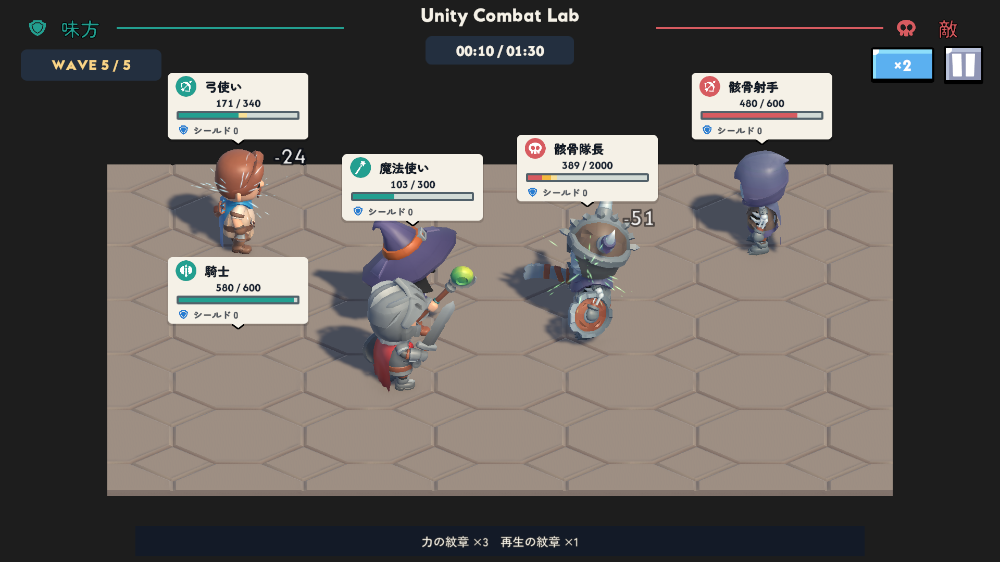
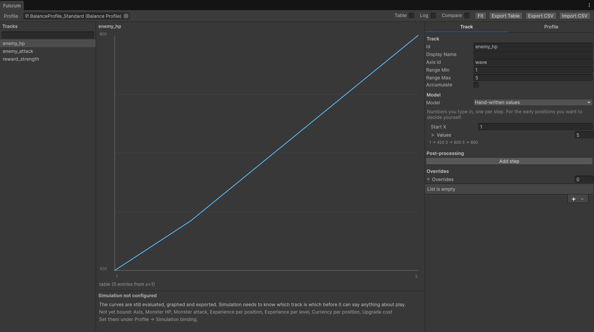
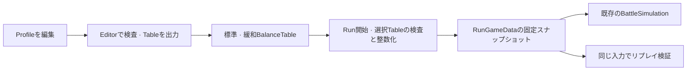
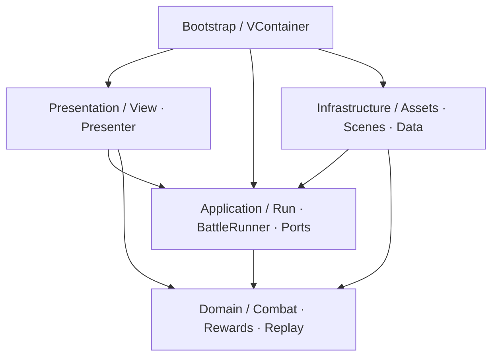

# Unity Combat Lab

[日本語](README.md) | [한국어](README.ko.md) | [English](README.en.md)

**目次:** [紹介](#プロジェクト紹介) · [使用環境](#使用環境とライブラリ) · [Fulcrum](#fulcrumの紹介) · [コード構成](#コード構成) · [検証結果](#テストと検証結果) · [実装詳細](#実装と設計上の判断) · [起動方法](#プロジェクトの起動とアセットの復元)

## プロジェクト紹介

**3人のヒーローを配置し、ウェーブ間で強化を選びながら、全5ウェーブの自動戦闘に挑むUnityクライアント開発のポートフォリオです。**

騎士・弓使い・魔法使いの前列／後列への配置と、強化の組み合わせによって戦闘結果が変わります。タイトル → 編成 → 戦闘 → 強化選択 → リザルト → 再挑戦まで、一通りのゲーム進行を実装しています。ゲームUIは日本語です。このREADMEでは、コードと設計上の判断を説明します。**Run**は、編成を終えて出発してから、クリア・敗北・途中終了に至るまでの1回のプレイを指します。

購入アセットはリポジトリに含めていないため、Unityで実行するには[アセットと参照の復元](#プロジェクトの起動とアセットの復元)が必要です。

> **現在開発中のポートフォリオであり、完成版ではありません。** 主要なゲームフローとFulcrumのバランスデータ連携を実装しました。サウンドの追加、安定性の確認、ロジックの改善は今後の作業です。



## 使用環境とライブラリ

バージョンは、このプロジェクトで確認したインストール済みのものです。UPMの構成は[manifest.json](Packages/manifest.json)と[packages-lock.json](Packages/packages-lock.json)、NuGetの構成は[packages.config](Assets/packages.config)に記載しています。

| 技術 | バージョン | 使用箇所と採用理由 |
|---|---|---|
| Unity / C# | **6000.3.8f1** | シーン・プレハブ・Animatorとゲームクライアントの実装。[ProjectVersion](ProjectSettings/ProjectVersion.txt) |
| Universal Render Pipeline | **17.3.0** | 3Dの戦闘ステージとキャラクターの描画。[レンダリング設定](Assets/UnityCombatLab/Settings) |
| uGUI / TextMeshPro | **uGUI 2.0.0に含まれる** | 明示的に接続するView、日本語UI、数値表示。[UIコード](Assets/UnityCombatLab/Scripts/Presentation/UI) |
| VContainer | **1.19.0** | アプリ・シーンのオブジェクト構築とEntryPointの接続。コンテナへのアクセスを[Bootstrap](Assets/UnityCombatLab/Scripts/Bootstrap)に集約 |
| UniTask | **2.5.11** | アセットの準備、シーン遷移、次のフレーム待機、キャンセル処理。[RunFlowCoordinator](Assets/UnityCombatLab/Scripts/Application/Run/RunFlowCoordinator.cs) |
| R3 | **1.3.1** — core + Unity連携 | HP・シールド・被ダメージ後の予測HPの変更購読と解除。[BattleHudPresenter](Assets/UnityCombatLab/Scripts/Presentation/UI/BattleHudPresenter.cs) |
| DOTween Standard | **1.3.045** | UIポップアップ、ボタンの反応、移動・被弾・ダメージ数値の演出。[UiTweenUtility](Assets/UnityCombatLab/Scripts/Presentation/UI/UiTweenUtility.cs), [UnitView](Assets/UnityCombatLab/Scripts/Presentation/Units/UnitView.cs) |
| Addressables | **2.8.1** | ローカルのユニット定義・プレハブ・UI・アイコンのロード。[RunAssetScope](Assets/UnityCombatLab/Scripts/Infrastructure/Assets/RunAssetScope.cs) |
| Input System | **1.18.0** | EventSystemのUI入力とEsc入力。[RunBattleView](Assets/UnityCombatLab/Scripts/Presentation/UI/RunBattleView.cs) |
| Unity Test Framework / NUnit | **1.6.0パッケージ** | 戦闘・進行のEditModeテストと、Unityオブジェクト・アセットのライフサイクルを扱うPlayModeテスト。[Tests](Assets/UnityCombatLab/Tests) |
| NuGetForUnity | **4.5.0** | R3 coreと関連する.NET依存関係の復元 |
| Fulcrum | **0.4.0 / MIT / embedded** | ウェーブごとの数値作成・Table出力とRun入力への変換。[パッケージの出典](Packages/FULCRUM_SOURCE.md) |

開発環境はRider **2026.2.3.1** / Unity Rider Editor **3.0.39**、Unity CLI **1.0.0-beta.14** / Pipeline **0.9.1-exp.1**です。CLI・MCPはエディター操作と検証に使用しました。

## ゲーム構成

https://github.com/user-attachments/assets/15fbbef9-a48c-4ae0-be49-c97b5fea7cce

[プレイ動画全編 (MP4 · 62 s · 1.9 MB)](Docs/Videos/gameplay-demo.mp4)

- **編成：** 騎士・弓使い・魔法使いを前列、後列上段、後列下段に配置します。カードとスロットを選んで配置を入れ替えます。
- **戦闘：** 味方3人と最大3体の敵が自動で戦います。騎士は被ダメージ軽減、弓使いは一定回数ごとの強力な単体攻撃、魔法使いは一定回数ごとの範囲攻撃を持ちます。
- **強化：** 最終ウェーブを除く各ウェーブの勝利後、最大3つの候補から1つを選びます。攻撃力・最大HP・攻撃速度・シールド・撃破時回復・戦闘序盤の攻撃力の6種類があり、それぞれ最大3回まで重ねられます。
- **進行：** 次のウェーブでは味方が復活し、強化後の最大HPまで回復します。強化は1回のプレイ中だけ維持され、再挑戦時にリセットされます。
- **操作：** 1倍／2倍速、一時停止・再開、終了確認に対応しています。フォーカスを失うと自動で一時停止し、操作によって再開します。

## 主な課題と解決方法

小規模な自動戦闘ゲームでも、**戦闘の判定が確定する時点と、画面に表示する時点**、**画面が終了する時点と、ロードが完了する時点**は一致しません。また、同じ戦闘を再現できても、意図しないルール変更まで検出できるとは限りません。このプロジェクトでは、次の4つの課題を軸に実装とテストを構成しています。

| 課題 | 解決方法 | 主なコード |
|---|---|---|
| 飛び道具が命中する前にHPが減り、ダメージと回復の表示順序がずれる | 確定した戦闘状態と表示状態を分離し、回復前後の適用順序を保つ | [UnitPresentationReadModel](Assets/UnityCombatLab/Scripts/Presentation/ReadModels/UnitPresentationReadModel.cs), [BattlePresenter](Assets/UnityCombatLab/Scripts/Presentation/Units/BattlePresenter.cs) |
| キャンセルや画面終了の後にロードが完了し、アセットの解放責任が曖昧になる | 成功したロードの所有権をLeaseに渡し、終了済みのScopeに届いた結果は即座に解放する | [AddressableAssetScope](Assets/UnityCombatLab/Scripts/Infrastructure/Assets/AddressableAssetScope.cs), [RunFlowCoordinator](Assets/UnityCombatLab/Scripts/Application/Run/RunFlowCoordinator.cs) |
| 誤って変更した戦闘ルールでも、現在のコードで再実行すると同じ結果になる | 20Hzの決定論的な戦闘の再現検証に加え、独立した固定期待値による回帰テストを用意する | [BattleRunner](Assets/UnityCombatLab/Scripts/Application/Battle/BattleRunner.cs), [RunReplayTests](Assets/UnityCombatLab/Tests/EditMode/RunReplayTests.cs) |
| 前の画面の入力やRun状態が次の進行に混ざり、強化が重複適用されたり再挑戦時に初期化されなかったりする | Run ID・状態・候補を検査し、編集データと1回のプレイの実行状態を分離する | [RunController](Assets/UnityCombatLab/Scripts/Application/Run/RunController.cs), [RunProgress](Assets/UnityCombatLab/Scripts/Domain/Run/RunProgress.cs) |

戦闘ルール、画面の表示タイミング、アセットのロード方式をそれぞれ変更・検査できるように責任を分けました。レイヤーごとのアセンブリとDIは実装の接続を、表示専用の読み取りモデルはHUDに見せる状態を、アセットScopeは解放範囲を担当します。**変更するコードと確認するテストの範囲を明確にすること**が目的です。戦闘スロットや状態遷移のように要件が小さい部分は、固定配列とenumで実装しています。

## Fulcrumの紹介

**Fulcrumは、個人で開発・管理しているUnity Editor向けのゲームバランス制作ツールです。** 成長曲線や数値データをグラフで確認しながら編集し、ゲームが読み込めるTableやCSVとして出力します。繰り返し調整するバランスデータをコードから分離して管理し、数値の変化を一目で確認するために制作しました。

Profileは軸・トラック・計算モデルを持つ編集元データで、BalanceTableはProfileを評価して得た出力データです。Fulcrum自体には汎用のシミュレーション・検証機能もありますが、実際のゲームルールと結果の検証は各ゲームの戦闘コアが担当するように分けています。

## このプロジェクトでのFulcrum活用

Unity Combat Labでは、Fulcrumで**ウェーブごとの敵HP・攻撃力と、強化効果の倍率**を管理しています。ゲームのC#コード内の数値を直接変更する代わりに、標準・緩和難易度のProfileを編集し、Tableを再出力して次のRunに反映します。以下は、このプロジェクトに接続した実際のProfileと利用の流れです。



上の画面は、このゲームで使用する`BalanceProfile_Standard`の`enemy_hp`トラックです。横軸は**1〜5ウェーブ**、縦軸は**役割係数を掛ける前の敵HP**です。現在のモデルは5つの値を直接入力する**Hand-written values**で、右側の`Values`を展開して各ウェーブの値を変えると、中央のグラフも変化します。例えば1ウェーブ目のHPを上げると、そのウェーブの敵を倒すために必要な攻撃回数が増えます。

### グラフから実際の戦闘までの接続



[RunBalanceExporter](Assets/UnityCombatLab/Editor/RunBalanceExporter.cs)は、Profileの`wave`軸1〜5、必須トラック、標準・緩和の関係を検査します。Tableには軸名が保存されないため、[FulcrumBalanceAdapter](Assets/UnityCombatLab/Scripts/Infrastructure/Balance/FulcrumBalanceAdapter.cs)はゲーム開始時にトラックの欠落・範囲不足・NaN/Infinity・入力の安全範囲を確認します。不正な値は既定値に置き換えずRun開始を拒否し、既存の資産解放とエラー表示の経路へ渡します。

[RunDefinition](Assets/UnityCombatLab/Scripts/Infrastructure/Balance/RunDefinition.cs)は難易度ごとのTableを選び、敵配置を持つ[WaveDefinition](Assets/UnityCombatLab/Scripts/Infrastructure/Balance/WaveDefinition.cs)と組み合わせて、純粋なC#の[RunGameData](Assets/UnityCombatLab/Scripts/Domain/Run/RunGameData.cs)を作ります。Domain/ApplicationにはFulcrum型を渡さず、ゲームランタイムからの直接参照はInfrastructureの`Fulcrum.Core`に限定します。進行中のRunとリプレイはこの固定スナップショットを使うため、その後のProfile編集の影響を受けません。

**このグラフは入力数値を示すもので、ゲームの勝敗を予測するグラフではありません。** 画面下部の`Simulation not configured`は、このProfileにFulcrum自体の汎用シミュレーターを設定していないことを示します。ゲームの戦闘は既存の`BattleSimulation`が実行し、結果の再現性はゲームの`RunReplayVerifier`で確認します。二つのシミュレーターを同期したり、実行中のゲーム数値をリアルタイムに上書きしたりする機能はありません。

### このゲームで調整する値

| トラック | ゲームに適用する値 | 標準Profileの1〜5ウェーブ初期値 |
|---|---|---|
| `enemy_hp` | 敵の役割係数を掛ける前の基本HP | 420 / 500 / 600 / 700 / 800 |
| `enemy_attack` | 敵の役割係数を掛ける前の基本攻撃力 | 12 / 14 / 17 / 20 / 24 |
| `reward_strength` | 強化選択時の基本効果に掛ける倍率 | 1.00 / 1.10 / 1.20 / 1.30 / 1.40 |

`reward_strength`は敵撃破時の報酬金額ではなく、**選択する強化の効果倍率**です。基本の攻撃力強化が+15%で、そのウェーブの倍率が1.10なら、その選択は+16.5%として確定しRunに保存されます。5ウェーブ目の値もTableにはありますが、最終勝利後に強化選択はありません。

### 変更した数値をゲームへ反映する手順

1. Unityメニューの**Window → Fulcrum → Balance Editor**を開きます。
2. 上部の`Profile`に[BalanceProfile_Standard](Assets/UnityCombatLab/Data/Balance/BalanceProfile_Standard.asset)を指定し、左のトラックを選んで、右のモデルの`Values`を変更します。配列の先頭から1〜5ウェーブに対応します。
3. [BalanceProfile_Easy](Assets/UnityCombatLab/Data/Balance/BalanceProfile_Easy.asset)も、敵HP・攻撃力が標準の80%、強化倍率が同じ値になるように合わせます。二つのProfileは自動同期されません。
4. **Playモードを終了した状態でTools → UnityCombatLab → Export Run Balance Tables**を実行します。両Profileを検査して既存の標準・緩和Tableを更新します。グラフ画面の汎用`Export Table`ではなくゲーム専用メニューを使うことで、軸・入力範囲・難易度比率まで確認できます。
5. Playモードの編成画面で難易度を選び、**新しいRunを開始**します。選択した難易度の最新Tableが適用されます。

**Profileを編集して保存するだけでは、ゲームには適用されません。** 明示的にTableを出力する必要があり、開始済みのRunは最初に読み込んだ値を最後まで使います。`BalanceTable_Standard`と`BalanceTable_Easy`は出力結果なので、編集はProfileで行います。

例えば標準の1ウェーブ目HPを`420 → 500`に変えるなら、緩和も`336 → 400`に合わせて再出力します。次のRunの近接敵は、それぞれ500 / 400 HPで始まります。勝敗やクリア時間への影響は、実際のゲームコアで改めて確認します。

### 入力変換とパッケージ構成

緩和難易度のProfileは、標準の**敵HP・攻撃力×0.8**で、強化倍率は同じです。HPと攻撃力はTableを読むときに`MidpointRounding.AwayFromZero`で整数化するため、緩和の基本攻撃力は`10 / 11 / 14 / 16 / 19`です。その後の遠距離・隊長などの役割係数とダメージ計算には、既存の整数切り捨て規則を使います。例えば緩和1ウェーブ目の攻撃力は`12 × 0.8 = 9.6 → 10`で、ゲーム側で再度80%を掛けることはありません。

Fulcrum **0.4.0**は、検証した原本revisionのパッケージだけを`Packages/com.hakrimryu.fulcrum`へembeddedで含めています。個人PCの絶対パスや非公開リポジトリへのアクセスには依存しません。使用revisionと出典は[FULCRUM_SOURCE](Packages/FULCRUM_SOURCE.md)、MITの著作権・許可文は[LICENSE](Packages/com.hakrimryu.fulcrum/LICENSE.md)に保存しています。連携の回帰テストは[FulcrumBalanceAdapterTests](Assets/UnityCombatLab/Tests/EditMode/FulcrumBalanceAdapterTests.cs)にあります。

## コード構成

戦闘ルールの変更、画面上の命中タイミングの変更、アセットのロード方式の変更で、それぞれ修正する範囲を分けています。この責任分離を**Clean Architecture Lite + MVP/Passive View**で構成し、更新頻度の高いHUDの値にR3を適用しました。クリックや画面遷移は、C#イベントと明示的なメソッド呼び出しで扱います。

以下の矢印は、主なコードの依存方向を示しています。Commonのenum・固定規約への参照は省略しています。



[Domain asmdef](Assets/UnityCombatLab/Scripts/Domain/UnityCombatLab.Domain.asmdef)は`noEngineReferences: true`で、Commonのみを参照します。戦闘ルールとリプレイはUnityの画面なしで実行できます。[Application](Assets/UnityCombatLab/Scripts/Application/UnityCombatLab.Application.asmdef)もUnityEngineを参照しませんが、進行・非同期フロー・読み取りモデルにはUniTaskとR3を使用します。

ウェーブの進行方針は[RunBattleCoordinator](Assets/UnityCombatLab/Scripts/Application/Run/RunBattleCoordinator.cs)に置き、[RunBattleEntryPoint](Assets/UnityCombatLab/Scripts/Bootstrap/RunBattleEntryPoint.cs)でUnityオブジェクトの生成とフレーム・フォーカス入力を接続します。これにより、次のウェーブへ進む条件を検証する際に、シーンやキャラクターを準備する必要がなくなります。

**VContainerは、具体的な実装を組み立てる場所で使用しています。** [AppLifetimeScope.Configure](Assets/UnityCombatLab/Scripts/Bootstrap/AppLifetimeScope.cs)で、進行を調整するオブジェクトにシーン遷移、アセット生成関数、フレーム待機、エラー報告を接続します。

```csharp
builder.Register(resolver => new RunFlowCoordinator
(resolver.Resolve<SceneTransitionManager>(),
    loading,
    configuration => new RunAssetScope(resolver.Resolve<AddressableAssetManager>(), _uiAssets, _unitAssets, _runDefinition, configuration),
    () => UniTask.NextFrame(),
    Debug.LogException,
    value => AudioListener.volume = value), Lifetime.Singleton);
builder.RegisterEntryPoint<AppEntryPoint>().AsSelf();
```

テストではこの接続をテストダブルに置き換え、ロード完了やフレーム待機のタイミングを直接制御します。Domainからコンテナを参照することはありません。VContainerのシーンScopeとRunアセットのライフサイクルは別に管理し、[実装詳細の所有期間の表](#2-画面が終了した後にアセットのロードが完了する)のように、1回のRunで保持するアセットとウェーブごとに入れ替える戦闘オブジェクトを分けています。

データ構造と状態の表現は、実際に扱う規模に合わせています。[BattleSimulation.FindTarget](Assets/UnityCombatLab/Scripts/Domain/Battle/BattleSimulation.cs)は最大3つの敵スロットを決まった順序で調べ、Unit IDからViewを引く箇所にはDictionaryを使用します。`RunController`の状態はenumと許可する遷移の検査で表現しています。

## テストと検証結果

**2026-10-27にUnity EditorでFulcrum連携を含めて実行した検証結果**です。実際の戦闘はEditorのフレームで進め、開発用の入力APIで編成・倍速・強化を選びました。マウスによる操作全体を自動化した検証ではありません。

| 検証 | 結果 |
|---|---|
| EditMode | **177 / 177成功** |
| PlayMode | **47 / 47成功** |
| 実際のEditor戦闘 — 標準 | 5/5ウェーブ勝利、**1090tick / 455イベント**、リプレイ**MATCH**（`3F80450CE314E9DB`） |
| 実際のEditor戦闘 — 緩和 | 5/5ウェーブ勝利、**872tick / 371イベント**、リプレイ**MATCH**（`E504B1BB12FD5095`） |
| 不正なTableでの出発 | 必須トラック・範囲・異常値を拒否。Table欠落時に取得済み資産を解放し、エラー画面へ戻ることを確認 |
| 実行環境 | Unity 6000.3.8f1、Addressables Asset Database / Fast Mode |

実プレイの1090tick/455イベントと、テスト専用の固定入力による386tick/152イベントは、異なる入力に対する結果です。

関連テストコードは、後述の[実装と設計上の判断](#実装と設計上の判断)の各事例から参照できます。数値計算に加えて、表示順序、遅れて完了する非同期処理、重複入力、再挑戦を検査する構成です。

Fulcrumの出力が実際の戦闘につながることも、以下の手順で確認しました。編成は魔法使い/弓使い/騎士、シードは`20261024`、強化順は攻撃力 → 攻撃力 → 撃破時回復 → 攻撃力です。

| 検証段階 | 実際に確認した動作 |
|---|---|
| 標準Run開始後にProfileを再出力 | 検証用に1ウェーブ目HPを420から1,000,000へ変更し、緩和も80%に合わせて出力。進行中のRunは既存のHP420を維持し、従来と同じ結果で勝利 |
| 変更後の新しい標準Run | 新しいTableのHP1,000,000を使い、**1800tickの時間切れ / 501イベント**へ結果が変化。リプレイ**MATCH**（`3646720722658195`） |
| 基本値を復元した後の緩和Run | 1ウェーブ目HP336・攻撃力10で開始して5ウェーブ勝利。終了後のユニット破棄を確認 |

1,000,000 HPは推奨バランスではなく、**入力の変更が実際の結果へ反映されることを確認するための検証値**です。この再出力検証は開発用Editor APIで行い、通常の利用メニューは前述の手順どおりEditモードで実行します。検証後、Profile・Tableとmetaは検証前のファイルとバイト単位で一致するよう復元しました。

現在の提出対象はGitHubリポジトリです。Android/WebGLのビルド・配布と実機性能検証は保留中であり、上記のEditor結果で代替しません。購入アセットを除いた新規cloneからの完全な復元も未検証です。

## 実装と設計上の判断

以下のコードブロックは、実装の要点を抜粋したものです。各事例にコード全体と関連テストへのリンクを記載しています。

### 1. 判定は確定したが、矢はまだ届いていない

**課題：** 戦闘tickでダメージを計算した直後にHUDを更新すると、矢が命中する前にHPが減ります。逆に、ダメージ計算をアニメーションやTweenの完了時に行うと、演出時間や倍速の変更が戦闘ルールに影響します。

**設計判断：** ダメージ・死亡・勝敗は純粋なC#の戦闘コアで確定し、画面には命中時点でその結果を反映します。Applicationの`BattleReadModel`は確定状態を、Presentationの`BattlePresentationReadModel`は表示状態を保持します。[BattlePresentationTimeline](Assets/UnityCombatLab/Scripts/Presentation/Units/BattlePresentationTimeline.cs)が攻撃動作と命中の予定を管理し、[BattlePresenter](Assets/UnityCombatLab/Scripts/Presentation/Units/BattlePresenter.cs)がユニットとHUDをつなぎます。

すべてのイベントを受信順に表示すると、到着の遅い魔法弾を待つために、先に命中した近接攻撃まで待たされます。そこで、**ダメージ同士は命中順に表示し、回復の前後では確定順を守る**ようにしました。[UnitPresentationReadModel.PresentChange](Assets/UnityCombatLab/Scripts/Presentation/ReadModels/UnitPresentationReadModel.cs)がこの順序を管理します。HPを適用した後に`ChangePresented`で通知し、同じダメージの数値と被弾演出を表示します。

例えば、テストで扱うHPの変化が`100 → ダメージ16 → 回復8 → ダメージ16`の場合、最後のダメージの演出が先に到着しても、HPは`100 → 84 → 92 → 76`の順に表示します。回復を追い越してダメージを適用しないことと、HPを更新する前にダメージ数値だけが表示されないことを確認します。

**R3は、表示状態の変更をHUDに伝えるために使用しています。** [BattleHudPresenter](Assets/UnityCombatLab/Scripts/Presentation/UI/BattleHudPresenter.cs)の購読処理は次のとおりです。

```csharp
unit.Health.Subscribe(value =>
{
    if (!_isDisposed && status != null)
    {
        status.SetHealth(value, unit.Input.MaxHealth);
    }
}).AddTo(_subscriptions);
```

Presenterが`_subscriptions`を所有し、`Dispose()`で購読を解除します。確定状態と表示状態を別々に管理するコストはありますが、演出タイミングを変えても、戦闘計算とそのテストを維持できます。最後の命中・死亡演出を終えてから、次のウェーブやリザルトへ進みます。

**DOTweenは、この流れの視覚表現を担当します。** [UnitView](Assets/UnityCombatLab/Scripts/Presentation/Units/UnitView.cs)の接近・復帰や被弾、[DamageNumberView](Assets/UnityCombatLab/Scripts/Presentation/UI/DamageNumberView.cs)のダメージ数値、UIポップアップに使用しています。一時停止中もメニューは操作できるよう、共通UIには独立した時間を使います。以下は[UiTweenUtility.PopIn](Assets/UnityCombatLab/Scripts/Presentation/UI/UiTweenUtility.cs)の戻り値を構成する部分です。

```csharp
return DOTween.Sequence()
    .Append(content.DOScale(Vector3.one, seconds).SetEase(Ease.OutBack, 1.7f))
    .Join(DOTween.To(() => group.alpha, alpha => group.alpha = alpha, 1f,
        Mathf.Min(seconds, 0.18f)).SetEase(Ease.OutQuad))
    .SetUpdate(true)
    .SetRecyclable(false);
```

戦闘に属するAnimator・Tween・Particle・ダメージ数値には、別途0／1／2倍の再生速度を渡します。VFXは[UnitEffectsView](Assets/UnityCombatLab/Scripts/Presentation/Units/UnitEffectsView.cs)が対象スロットごとに持つインスタンスを再利用します。ダメージ数値は、初期の3つの表示スロットがすべて使用中なら追加し、表示途中の数値を残します。スロットの返却時にはTweenを終了し、世代番号を更新することで、古いコールバックが再利用後のスロットに作用するのを防ぎます。

**関連テスト：** [UnitPresentationReadModelTests](Assets/UnityCombatLab/Tests/EditMode/UnitPresentationReadModelTests.cs)では、ダメージの到着順、回復前後の順序、HP適用後の通知を検証します。[BattlePresentationTests](Assets/UnityCombatLab/Tests/PlayMode/BattlePresentationTests.cs)では、Unityの表示オブジェクトと購読・演出のライフサイクルを扱います。

### 2. 画面が終了した後に、アセットのロードが完了する

**課題：** ロードを待つRunがキャンセルされたり、画面が破棄されたりしても、開始済みのロードは後から完了する場合があります。待機中の処理だけを抜けると、誰が結果を解放するのかが曖昧になります。一方、表示オブジェクトが残っている間にアセットを先に解放することも避ける必要があります。

**設計判断：** ロードの完了と呼び出し側のキャンセルを区別し、ロードに成功するたびに解放責任を持つ[AddressableAssetLease](Assets/UnityCombatLab/Scripts/Infrastructure/Assets/AddressableAssetLease.cs)を返します。[AddressableAssetManager.LoadAsync](Assets/UnityCombatLab/Scripts/Infrastructure/Assets/AddressableAssetManager.cs)は、UniTaskで内部ロードの完了を待ってからキャンセルを確認します。

```csharp
var handle = Addressables.LoadAssetAsync<T>(reference.RuntimeKey);
try
{
    var asset = await handle;
    cancellationToken.ThrowIfCancellationRequested();
    if (asset == null)
        throw new InvalidOperationException($"Asset {reference.RuntimeKey} did not produce {typeof(T).Name}.");

    return new AddressableAssetLease<T>(handle);
}
catch
{
    if (handle.IsValid())
        Addressables.Release(handle);

    throw;
}
```

成功時はLeaseがハンドルを所有し、失敗・キャンセル時はローダーが解放します。画面やRunが使用するLeaseは、[AddressableAssetScope](Assets/UnityCombatLab/Scripts/Infrastructure/Assets/AddressableAssetScope.cs)がまとめて管理します。Scopeが先に終了していた場合、後から届いた結果は保持せず、その場で解放します。

```csharp
var lease = await _assets.LoadAsync(reference, cancellationToken);
if (_isDisposed)
{
    lease.Dispose();
    throw new ObjectDisposedException(nameof(AddressableAssetScope));
}
```

この方式では、キャンセルへの即時応答よりも、**進行中のロードの解放責任を最後まで維持すること**を優先しています。Addressablesはローカルのユニット定義・プレハブ・UI・アイコンに使用し、[RunAssetScope](Assets/UnityCombatLab/Scripts/Infrastructure/Assets/RunAssetScope.cs)で準備したアセットを5ウェーブの間保持します。VFXもユニットのプレハブの依存アセットとして保持するため、攻撃のたびにロードし直しません。

Runの終了時も処理順序を明示しています。[RunSession](Assets/UnityCombatLab/Scripts/Application/Run/RunSession.cs)がキャンセルトークンを所有し、[RunFlowCoordinator.EndRunAsync](Assets/UnityCombatLab/Scripts/Application/Run/RunFlowCoordinator.cs)が入力をロックした後、**キャンセル要求 → 購読・演出・Viewの終了処理 → 次のフレームを待機 → アセット解放**の順に進めます。

```csharp
session.Cancel();
ShowTransitionSafely(Define.RunTransitionPhase.CleaningUp);
session.Battle?.Dispose();
await _nextFrame();
if (_isDisposed)
    return;

session.Resources.Dispose();
```

次のフレームを待つのは、Unityの`Destroy`処理が終わってからアセットを解放するためです。キャンセル済みのRunトークンを、必須の終了処理にまで適用しないようにしています。その後、Frontendを準備し、Runの状態を整理します。

| 所有期間 | 保持する対象と終了タイミング |
|---|---|
| AppRoot | 共通のシーン遷移・ローディングUI・EventSystemなど。アプリの存続中に使用 |
| Frontendシーン | タイトル・編成・リザルト・エラーUI、Presenter、画面用アセット。シーン終了時に解放 |
| Run | キャンセルトークン、ユニット・UIアセット、進行データ、強化履歴。Run終了時に解放 |
| Dungeon／ウェーブ | 戦闘Canvas・操作UIはシーンが所有。Runner・ユニット・HUD・購読・演出はウェーブごとに入れ替え |

**関連テスト：** [AddressableAssetTests](Assets/UnityCombatLab/Tests/PlayMode/AddressableAssetTests.cs)では、共有アセットの最後の所有元による解放、キャンセル後のロード完了、Scope終了後に完了したロードの解放、ロード失敗後の再試行を検証します。[RunFlowCoordinatorTests](Assets/UnityCombatLab/Tests/EditMode/RunFlowCoordinatorTests.cs)では、終了処理中のフレーム待機とアプリのDisposeが重なるケースについて両方の完了順序を検証し、解放時の例外や終了後のUIアクセスも扱います。

### 3. 同じ結果を再現できても、ルールが正しく保たれたとは限らない

**課題：** フレーム間隔や1倍／2倍速の違いで攻撃回数や勝敗が変わると、バグを再現しにくくなります。この問題を解決しても、現在のコードで記録とリプレイの両方を計算すると、誤ったルール変更が両方に反映され、検証を通過する可能性があります。

**一つ目の対策は、戦闘時間と入力を固定することです。** [BattleSimulation.Step](Assets/UnityCombatLab/Scripts/Domain/Battle/BattleSimulation.cs)の1回は50ms、つまり20Hzです。HP・シールド・ダメージは整数、割合はbasis point（`10000 = 100%`）で計算します。[BattleRunner](Assets/UnityCombatLab/Scripts/Application/Battle/BattleRunner.cs)がフレーム時間をtick数に変換し、倍速はRunnerに渡す時間に適用します。

1tick分のイベントを読み取りモデルと各受信側に渡した後、コアに消費完了を通知します。

```csharp
_simulation.Step();
for (var index = 0; index < _simulation.EventCount; index++)
{
    var battleEvent = _simulation.GetEvent(index);
    ReadModel.Apply(battleEvent);
    EventOccurred?.Invoke(battleEvent);
    if (_isDisposed)
    {
        return;
    }
}

_simulation.AcknowledgeEvents();
```

コアは固定長のイベント配列を再利用します。未消費イベントの検査とRunnerの再入防止により、消費中のバッファが次のtickで上書きされるのを防ぎます。非同期演出が保持する`BattleEvent`は、値として渡します。

1フレームで最大**8tick**を処理し、残りの時間は持ち越します。負荷が高いと実時間より戦闘の進行が遅れる場合がありますが、論理tickは飛ばしません。行動順は**味方前列 → 敵前列 → 味方後列上段 → 敵後列上段 → 味方後列下段 → 敵後列下段**に固定しています。同じtick内でも先の攻撃で倒されたユニットは行動しないため、味方先行による有利さが生じます。このゲームでは、単純で再現可能な逐次判定を採用しました。

終了したRunの設定・シード・強化選択・イベント・結果は、[RunReplayRecord](Assets/UnityCombatLab/Scripts/Domain/Run/RunReplayRecord.cs)に保存します。[RunReplayVerifier](Assets/UnityCombatLab/Scripts/Domain/Run/RunReplayVerifier.cs)はUnityの画面を使わずに戦闘を再計算し、最初に異なったイベントや結果を報告します。イベントはフィールド順を固定してlittle-endianでシリアライズし、FNV-1a 64-bitで比較用のハッシュを計算します。実行ごとに変わるRun IDは比較から除外します。

**二つ目の対策は、現在の実行結果とは独立した回帰テストの基準を設けることです。** [RunReplayTests](Assets/UnityCombatLab/Tests/EditMode/RunReplayTests.cs)では、テスト専用の入力・編成・シード・強化選択を用意し、勝敗、ウェーブごとのtick数、イベント数、選択履歴、ハッシュを固定期待値と比較します。主な期待値は次のとおりです。

```csharp
private const ulong GoldenEventHash = 0x135806989FA96900UL;
private const int GoldenTotalTicks = 386;
private const int GoldenEventCount = 152;
```

| 検証 | 検出する変化 |
|---|---|
| 同じ入力を異なるフレーム間隔・1倍／2倍速で実行 | 実行タイミングによって戦闘イベントや結果が変わる |
| 記録したRunを画面なしで再計算 | 記録と再現結果が一致しない、またはイベント・選択履歴が改変されている |
| 固定入力を独立した期待値と比較 | 記録とリプレイの両方が変化していても、従来のルールで定めた結果との差分を検出する |

固定基準には、ルール変更時に合わせて管理するコストがあります。バランスやルールを意図的に変更した場合に限り、その根拠とともに期待値を更新する方針にしています。

**関連テスト：** [BattleSimulationTests](Assets/UnityCombatLab/Tests/EditMode/BattleSimulationTests.cs)ではターゲット・ダメージ・死亡・終了の順序を、[BattleRunnerTests](Assets/UnityCombatLab/Tests/EditMode/BattleRunnerTests.cs)では時間の蓄積・イベント消費・再入を検証します。[RunReplayTests](Assets/UnityCombatLab/Tests/EditMode/RunReplayTests.cs)では、フレーム間隔と倍速を組み合わせた3条件で固定結果を確認し、イベント欠落や強化増加量の改変も検出します。

### 4. 前の画面の入力や前回のRunの状態を、次の進行に持ち込まない

**課題：** 強化ボタンの連打や、前の画面から遅れて届くコールバックによって、同じ強化を二重に適用するおそれがあります。また、実行中の状態をScriptableObjectに残すと、再挑戦時に前回のHPや強化を引き継いでしまう可能性があります。

**設計判断：** [RunController](Assets/UnityCombatLab/Scripts/Application/Run/RunController.cs)が現在のRun IDと状態を検査し、[RunProgress](Assets/UnityCombatLab/Scripts/Domain/Run/RunProgress.cs)がウェーブ・提示候補・選択可否を確認します。選択に成功すると状態とウェーブが変わるため、次の入力で同じ選択を重ねて適用することはできません。

```csharp
public bool TrySelectReward(Guid runId, int wave, Define.RewardKind? kind)
{
    if (!Matches(runId, Define.RunPhase.RewardSelection) || !Progress.TryChoose(wave, kind))
        return false;

    SetPhase(Define.RunPhase.WaveIntro);
    return true;
}
```

強化候補は、明示的なシードを使う[xorshift32 PRNGと部分Fisher–Yates法](Assets/UnityCombatLab/Scripts/Domain/Run/RewardRandom.cs)で決定します。選択時の増加量を[RewardChoice](Assets/UnityCombatLab/Scripts/Domain/Run/RewardChoice.cs)に保存し、次のウェーブの報酬倍率によって過去の効果が再計算されないようにしています。

編集用データと実行状態も分離しています。[RunDefinition](Assets/UnityCombatLab/Scripts/Infrastructure/Balance/RunDefinition.cs)のScriptableObject設定を、検証済みのC#データである[RunGameData](Assets/UnityCombatLab/Scripts/Domain/Run/RunGameData.cs)に変換します。実際のHPや強化回数は、Runと戦闘オブジェクトが所有します。[RunBattlePresenter](Assets/UnityCombatLab/Scripts/Presentation/UI/RunBattlePresenter.cs)は、強化カードに必要な表示値を[RewardCardDisplay](Assets/UnityCombatLab/Scripts/Presentation/ReadModels/RewardCardDisplay.cs)として生成し、Viewに渡します。

**関連テスト：** [RunProgressTests](Assets/UnityCombatLab/Tests/EditMode/RunProgressTests.cs)では候補と重複選択を、[RunControllerTests](Assets/UnityCombatLab/Tests/EditMode/RunControllerTests.cs)では状態遷移と再挑戦時の初期化を検証します。[RunBattleCoordinatorTests](Assets/UnityCombatLab/Tests/EditMode/RunBattleCoordinatorTests.cs)では、画面なしでの5ウェーブ進行、フォーカス復帰、演出完了待ちを検証します。

## プロジェクトの起動とアセットの復元

購入アセットは、ライセンスに従ってリポジトリから除外しています。Unityで実行するには、モデル・テクスチャ・アニメーション・GUI・フォントと、プロジェクト用に派生させたマテリアル・VFXを復元する必要があります。

ローカルの開発環境は、次の手順で構築します。

1. Unity **6000.3.8f1**で、このリポジトリのルートを開きます。UPMパッケージはmanifest/lockに記載されたバージョンで復元します。
2. `NuGet > Restore Packages`から、[packages.config](Assets/packages.config)のR3 coreと依存パッケージを復元します。生成される`Assets/Packages/`はGitの追跡対象外です。
3. DOTween Standard **1.3.045**を公式配布版から復元し、`Tools > Demigiant > DOTween Utility Panel`で設定します。配布物とライセンス表記を保持し、`Assets/Plugins/Demigiant/`は公開リポジトリに含めません。
4. `Window > TextMeshPro > Import TMP Essential Resources`でTMPリソースを復元します。
5. 下記の外部アセットを所有している場合は、元のパス・GUIDを維持して各自でインポートします。購入アセットを他者からコピーする方法は使用しません。
6. アセットパックのインポート後、プロジェクト用のURP派生マテリアルとVFXラッパーを別途構成し、独自のユニット・UIプレハブとアセットカタログに参照を設定します。
7. アセットと参照を復元した後、[Boot.unity](Assets/UnityCombatLab/Scenes/Boot.unity)から開始します。Dungeonを直接実行するには、アクティブなRunが必要です。シーン順は[Define.SceneType](Assets/UnityCombatLab/Scripts/Common/Define.cs)の`Boot=0 / Dungeon=1 / Frontend=2`と一致させます。

検証時は、Unity Test RunnerのEditMode・PlayModeで`UnityCombatLab.Tests`を実行します。アセット参照を使用するテストには、上記の復元が必要です。戦闘終了後にPlayモードを維持したまま`UnityCombatLab > Development > Verify Last Run`を実行すると、直前に完了したRunの再現結果をConsoleで確認できます。

## 実装範囲と外部リソース

独自の実装範囲は、戦闘・強化・進行のルール、UIと演出の接続、非同期処理とアセットのライフサイクル管理、テストとリプレイ検証、プロジェクト専用のプレハブ・シーン構成です。画面に使用したキャラクター・背景・GUI・VFXの元アセットは、次の外部リソースです。

| リソース | 提供元／用途 | リポジトリでの扱い |
|---|---|---|
| KayKit Adventurers / Skeletons / Dungeon Remastered | Kay Lousberg／キャラクター・装備・アニメーション・ステージ | `Assets/KayKit/`の元アセットを除外 |
| GUI Pro - Minimal Game Light | LAYERLAB／UIグラフィック・アイコン、LTAvocado Bold・Afacad Flux ExtraBoldフォントの参照 | `Assets/Layer Lab/`の元アセットを除外 |
| [Epic Toon FX](https://assetstore.unity.com/packages/vfx/particles/epic-toon-fx-57772) | Archanor VFX／戦闘エフェクト | `Assets/Epic Toon FX/`の元アセットを除外 |
| プロジェクト用の派生マテリアル・VFXラッパー | 上記の購入アセットを使用したローカル構成 | `Assets/UnityCombatLab/Art/Restricted/`を除外 |
| Zen Maru Gothic Bold | Zen Maru Gothic Project Authors／日本語UI | 元フォントと生成したTMPアトラス、[NOTICE](Assets/UnityCombatLab/Art/Fonts/ZenMaruGothic/NOTICE.txt)・[OFL](Assets/UnityCombatLab/Art/Fonts/ZenMaruGothic/OFL.txt)を収録 |

公開対象から除外するパスは[.gitignore](.gitignore)に記載しています。独自のラッパーも外部リソースを参照するため、元アセットとプロジェクト用の派生アセットを合わせて復元する必要があります。

開発では、CodexとUnity CLI/MCPを使った実装のたたき台作成、エディター操作、検証の自動化も行っています。設計・スコープの判断、コードレビューと修正、プレイ確認を経て反映しました。

## 今後の開発予定

- **サウンドの追加：** BGMと戦闘・UIの効果音を追加する予定です。現在のデモにサウンドはありません。
- **ロジックの改善：** 実際の操作フローとテストをもとに既存ロジックを見直し、必要な箇所のリファクタリング・修正を進めます。
